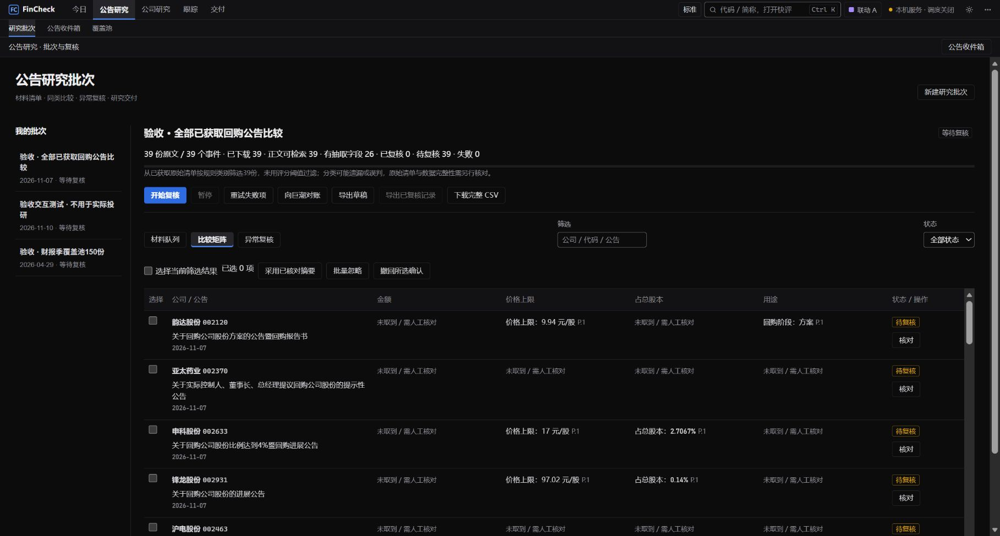
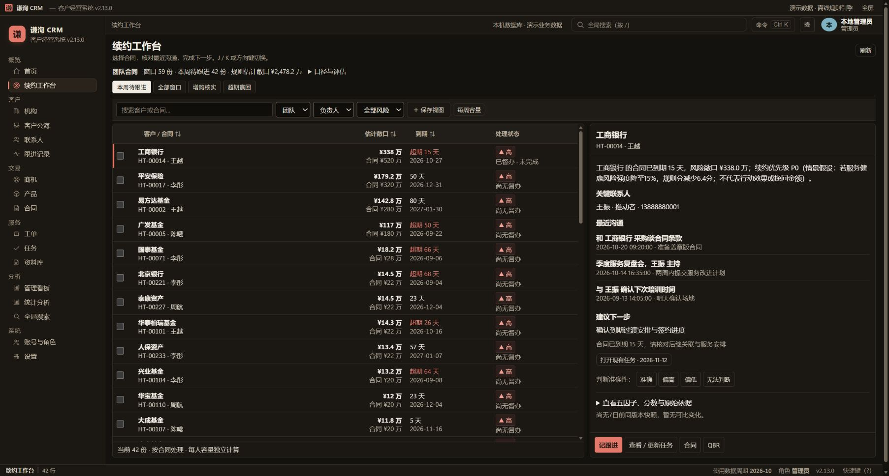

# 赵顾阳｜AI 产品经理 / 产品经理

**擅长复杂业务系统与 AI 人机协作设计，将业务问题转化为可执行、可核验的产品流程。**

浙江大学工科背景，8 年软件研发与产品经验，经历覆盖华为 MindStudio 开发工具、商城小程序及金融、社区业务。熟悉研发协作，使用 Claude Code、Codex 等工具构建可运行原型并验证方案。

**杭州 · 联系邮箱: zhaoguyang@126.com

以下两个项目均为我在谦洵任职期间负责并交付的产品。点击截图可查看大图，进入案例可阅读业务背景、本人职责与设计取舍。

## FinCheck｜公告批量研究与证据核验

新版专业外观用灰阶组织表格，蓝色标记当前视图和主要操作，琥珀色提示待复核项。

**解决的问题：** 买方研究员需要将大量公告与附件转化为可回查的结论，材料整理、数字核对和交付之间需要连续的处理流程。

**我的职责：** 产品规划、需求与流程设计、原型、交付协同及持续迭代。

三个关键设计：

- **完整材料处理：** 重点排序与材料清单分开，解析和人工复核分层计数。
- **证据约束问答：** 回答附引用，证据不足时保留回查和回退路径。
- **版本化交付：** 确认对应具体结果，来源变化后旧审核失效。

**[阅读 FinCheck 图文案例 →](fincheck/README.md)**

## 谦洵 CRM｜机构客户经营与合同续约

**解决的问题：** 机构客户的背景、承诺、跟进任务和续约结果需要关联起来，支持销售执行、主管督办与人员交接。

**我的职责：** 需求与业务流程设计、原型、需求评审和交付验收协同；入职前半年完成项目交付。

三个关键设计：

- **可维护的客户上下文：** 摘要有维护责任、核对依据及未完成事项。
- **跟进承接行动：** 沟通结论与下一步负责人、截止日一起组织。
- **按合同管理续约：** 前后继关系支撑状态核对和经营统计。

**[阅读 CRM 图文案例 →](crm/README.md)**

## 能力与联系

**业务抽象 · AI 人机协作 · 可运行原型 · 跨团队交付**

FinCheck 侧重模型、证据和人工判断的分工；CRM 侧重复杂业务对象、责任与指标口径。两篇案例均提供完整任务流程，补充验证和异常处理可按需展开。

邮箱：[zhaoguyang@126.com](mailto:zhaoguyang@126.com) · 求职方向：**AI 产品经理 / 产品经理** · 期望城市：**杭州**
