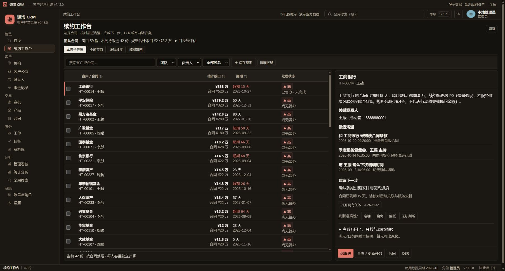
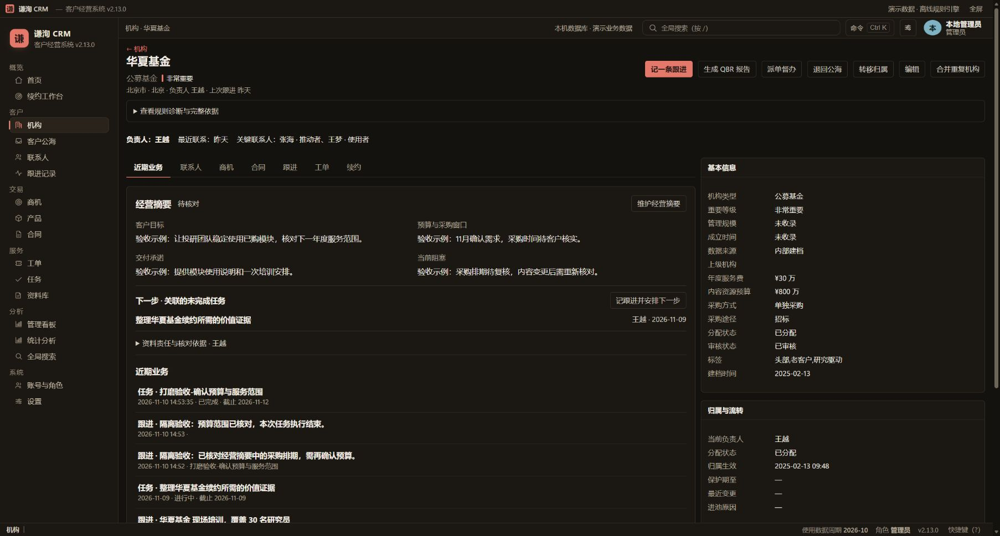
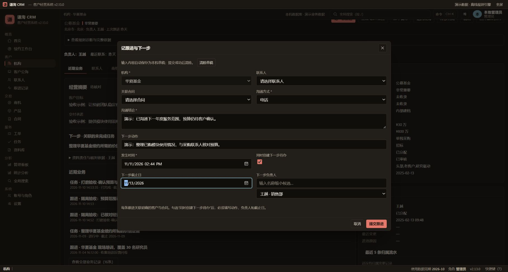
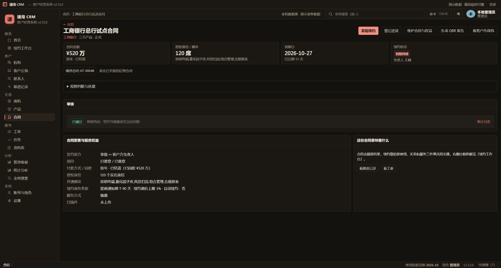
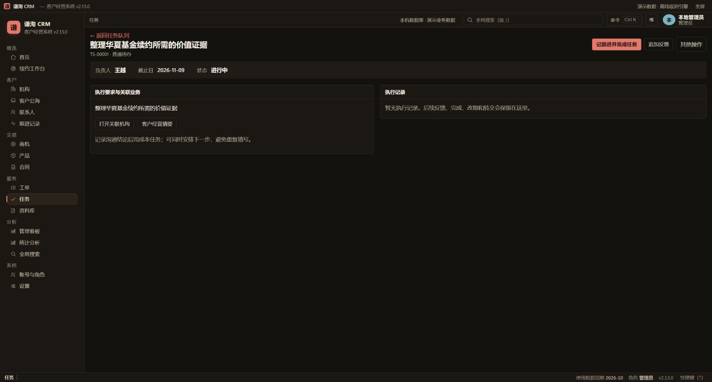
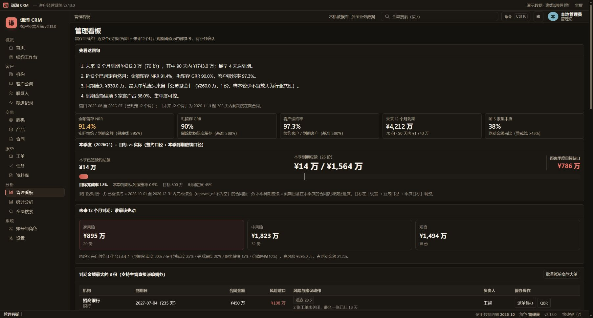

# 谦洵 CRM｜机构客户经营与合同续约

> 把客户背景、沟通承诺、下一步任务和续约结果连接起来，支持销售持续跟进、主管推动执行，以及人员交接。

[返回作品集首页](../README.md) · [阅读 FinCheck 案例](../fincheck/README.md)

**快速导航：** [项目概览](#overview) · [业务与流程](#workflow) · [三个核心决策](#decisions) · [价值与反思](#value) · [深入阅读](#details)

## 项目概览

| 项目 | 说明 |
|---|---|
| 业务背景 | 浙江谦洵私募基金管理有限公司内部机构客户经营 |
| 核心用户 | 销售、销售主管、管理员 |
| 我的角色 | 产品经理，负责需求与流程设计、原型、需求评审及交付验收协同 |
| 交付情况 | 入职前半年完成 CRM 项目交付 |
| 产品主线 | 客户上下文 → 跟进与执行 → 合同续约 → 经营复盘 |
| 智能辅助方式 | 规则优先级、纪要结构化草稿、模板复盘简报与预设意图问数 |

**这个项目最重要的设计，是让一条客户记录能够指向明确的下一步，并让执行结果回到同一个客户和合同上下文。**

**看图重点：** 左侧回答“先处理哪份合同”，右侧回答“为什么、最近谈了什么、下一步怎么做”。底部固定跟进、任务、合同和 QBR 入口，让判断直接衔接操作。

*本案例截图中的客户经营、合同金额与联系人信息为演示数据，用于说明流程和交互，不代表实际客户关系或经营成果。点击图片可查看大图。*

## 业务与流程

机构经营涉及多个联系人、采购窗口、服务权益和多份合同。产品要让销售找回背景、让沟通形成下一步，并让主管在交接与续约时看清责任和结果。

我负责组织机构、联系人、商机、合同、跟进和任务之间的关系，将业务规则转化为原型与需求，推进评审和交付验收协同。

| 步骤 | 用户动作 | 系统如何承接 |
|---|---|---|
| 恢复上下文 | 销售打开机构或合同 | 查看经营摘要、关键联系人、近期沟通和未完成任务 |
| 确定优先级 | 查看待跟进合同 | 展示到期、使用、关系、服务和价值等规则依据 |
| 记录沟通 | 填写结论及下一步 | 指定负责人和截止日，关联对应机构与合同 |
| 推动执行 | 完成、反馈、改期或转交 | 保留结果和责任变化；主管可派发续约督办 |
| 确认续约 | 从原合同创建后继合同 | 核实签约、服务期及金额，形成可回查的合同链 |
| 经营复盘 | 核对队列、签约和留存 | 区分到期同群结果、季度签约额及实际回款 |

## 三个核心决策

### 决策一：客户摘要需要明确维护责任

**问题：** 摘要便于阅读，但容易出现信息过期、承诺无人核对，以及“保存过”被误认为“已经确认”的情况。

**选择：** 摘要保留维护人、核对依据和下次核对日；将内容保存与人工核对分开。编辑摘要后，原核对标记失效；多人编辑冲突时保留输入并要求刷新核对。

**取舍：** 增加少量维护操作，换取交接时对信息来源和有效性的判断依据。“已人工核对”表达有人确认过，并不代表系统验证了事实真实性。

**从截图读设计：** 客户目标、采购窗口、承诺与阻塞位于同一区域，下面直接关联未完成任务。画面保留“待核对”状态；资料责任与核对依据另有展开入口，避免把已保存内容误认为已核实事实。

### 决策二：跟进记录与下一步任务一起提交

**问题：** 只记录沟通，容易留下“联系过但没有后续”的状态；分开创建任务，又会增加重复输入和关联错误。

**选择：** 一次提交沟通结论、下一步动作、负责人和截止日。从原任务进入时，可同时完成原任务；必要校验失败时不产生部分成功，安全重试不重复创建。

**取舍：** 完成操作需要补齐必要信息，但后续参与者可以知道谁在何时做什么。普通下一步任务与主管续约督办分别表达，避免互相覆盖。

**从截图读设计：** “沟通结论”和“下一步动作”分开填写，勾选创建待办后补齐责任人与截止日。图中为未提交的演示草稿，体现同一表单如何承接记录与行动。

### 决策三：续约按合同组织，保留前后继关系

**问题：** 同一家机构可能同时购买不同产品或服务。仅按客户判断“已续约”，会混淆不同合同的结果。

**选择：** 从明确的原合同发起续约，建立新旧合同双向关系。新合同回款保持待核实，不沿用旧合同实收事实；签约结束相关续约督办，保留普通交付任务。

**取舍：** 合同关系维护更细，但业务状态和留存指标具备一致的核对基础。其他产品的新签合同不会自动替代原合同续约。

**从截图读设计：** 当前合同可以回查前序合同，但仍显示“尚无已关联的后继合同”和“到期待续”。中部审核虽然已通过，也不代表下一期续约完成；合同审核、服务安排与续接关系分别表达。

## 价值与反思

交付形成了客户资料、执行任务和续约合同之间的关联流程。评价价值时，先看找回客户背景、记录下一步和完成交接的任务表现，再看同一到期合同队列的留存与续接；不将演示看板数字当作经营成效。

**能力边界：** 智能辅助采用规则与模板，未接入外部大模型。规则分用于安排工作，不代表经过校准的流失概率。

这个项目的产品判断集中在三点：**信息要能指导行动，动作要能留下结果，业务口径要贯穿全流程。** 进一步优化应优先观察录入负担、交接断点和实际任务完成情况。

## 深入阅读

以下材料保留完整设计依据、补充页面和评价方法，可按关注点展开。

业务拆解与自研取舍

### 业务问题

机构客户经营涉及多个联系人、采购窗口、交付承诺、服务权益和多份合同。即使每个模块都有记录，销售仍需要回答：这家机构现在最关心什么，上次答应了什么，谁负责下一步，应该推进哪份合同？

产品围绕三个工作问题展开：

| 工作场景 | 需要解决的问题 | 产品落点 |
|---|---|---|
| 销售再次联系客户 | 快速恢复目标、关键联系人、承诺和阻塞 | 机构经营摘要与近期业务记录 |
| 沟通后的持续执行 | 明确下一步动作、责任人和截止日 | 跟进记录与任务关联提交 |
| 主管复盘与客户交接 | 看清执行进展、续约对象及未完成事项 | 督办、合同链、归属变更和经营看板 |

设计目标是降低找回背景、重复录入和交接断档的成本。具体效率收益需要用任务完成、耗时和返工记录衡量。

### 职责与范围

我负责梳理机构客户经营流程，组织客户、联系人、商机、合同、跟进和任务之间的关系，完成原型与需求说明，推动评审、开发协同和交付验收。

重点产品工作包括：

- 设计客户经营摘要，统一目标、采购窗口、交付承诺、阻塞和下一步的呈现。
- 将沟通结论转化为有责任人、有期限、有结果的任务，并明确改期、转交和督办规则。
- 按合同组织续约优先级和新旧合同关系，统一状态与统计口径。
- 设计规则依据、人工确认、未知数据及操作异常的表达方式。

### 为什么在已有自研 CRM 基础上继续建设

机构客户的多联系人、权益、多合同和续约关系需要与内部执行流程一起组织。沿用已有系统基础，有利于统一业务对象与口径，并针对具体任务调整交互。

这个选择也意味着持续承担维护、集成、权限和数据接管成本。评估自研价值时，需要比较通用产品的配置与实施成本、流程适配程度和长期维护成本，不能只比较一次开发费用。

任务执行详情与异常处理

**从截图读设计：** 任务详情将“记跟进并完成任务”作为主操作，同时保留追加反馈和关联客户入口。图中任务仍为进行中，右侧明确显示尚无执行记录，不以打开任务代替实际完成。

验收重点应覆盖：多人维护冲突、重复提交、跟进与任务部分失败、多合同串联错误、新合同回款误继承，以及未知数据被计算为正常值。

团队使用时，模块权限和“我的客户”筛选也需要区分；工作筛选不等于销售之间的数据隔离。部署到更严格的数据访问场景时，应单独评估行级权限及组织接管要求。

规则优先级与智能辅助分工

**问题：** 一个风险分不足以告诉销售应当做什么，也容易让主管把规则估计当成确定损失。

**选择：** 同时展示到期、使用、关系、服务和价值等依据，在判断旁提供跟进和督办入口。风险分与健康分分开：前者可以包含到期紧迫度，后者表达客户状态。

**取舍：** 保留人员对客户具体情况的判断。规则分用于组织工作，不表示经过校准的流失概率；缺数据明确显示未知。

| 环节 | 实际能力 | 人工与系统的分工 |
|---|---|---|
| 排优先级 | 规则综合多维信号并展示依据 | 销售核对客户情况，决定跟进顺序 |
| 整理纪要 | 规则解析形成结构化草稿 | 人工核实后保存，不能把草稿视为已提交记录 |
| 客户复盘 | 模板整理已有使用、服务和阅读事实 | 复制前核对，缺样本不填造收益或达标率 |
| 经营问数 | 支持范围内的预设意图查询 | 明确指标、范围与时间，避免把估计当事实 |
| 建议反馈 | 分别记录采纳情况和人工准确性反馈 | 采纳不直接等于建议正确或经营结果改善 |

**这里采用规则与模板驱动的辅助方式，未接入外部大模型。** 金额、合同状态和经营指标由确定性规则处理。未来若引入模型，应优先验证信息抽取和表达整理的价值，业务确认仍保留人工核对和系统校验。

经营看板、指标口径与评价方法

| 层级 | 观察指标 | 评价原则 |
|---|---|---|
| 任务体验 | 独立完成、求助、耗时、误录、返工、重复录入 | 先建立基线，再比较相同任务下的表现 |
| 执行质量 | 下一步是否明确、责任与期限是否完整、交接后能否继续处理 | 有记录不等于执行完成，需要核对结果 |
| 经营结果 | 到期合同同群的金额留存、机构续约及合同续接 | 使用相同样本范围，不与季度签约额或回款混用 |
| 规则质量 | 人工判断、历史时点样本、缺失覆盖 | 使用预测时点可得的信息，避免用事后数据评估 |

例如，合同金额净留存看同一到期队列的后继金额与原金额之比；总留存对每份原合同的后继金额按原额封顶。这样的口径设计，使增购、降购和续约能够被区分解释。

**从截图读设计：** 看板同时给出统计窗口，以及“本季已签续约”和“本季到期应续”两套口径，帮助主管判断结果差异来自哪里。图中百分比与金额均来自演示数据，展示的是指标组织方式，不作为项目成效。

产品交付形成了客户资料、执行任务和续约合同之间的关联流程。本文不填报缺少业务测量依据的提效或留存提升百分比。

内容依据

《谦洵 CRM · 产品需求文档》v3.4、《产品定位与自建理由-讲稿》及本人项目经历。案例重点呈现产品判断与业务规则。

---

[返回作品集首页](../README.md) · [阅读 FinCheck 案例](../fincheck/README.md)
