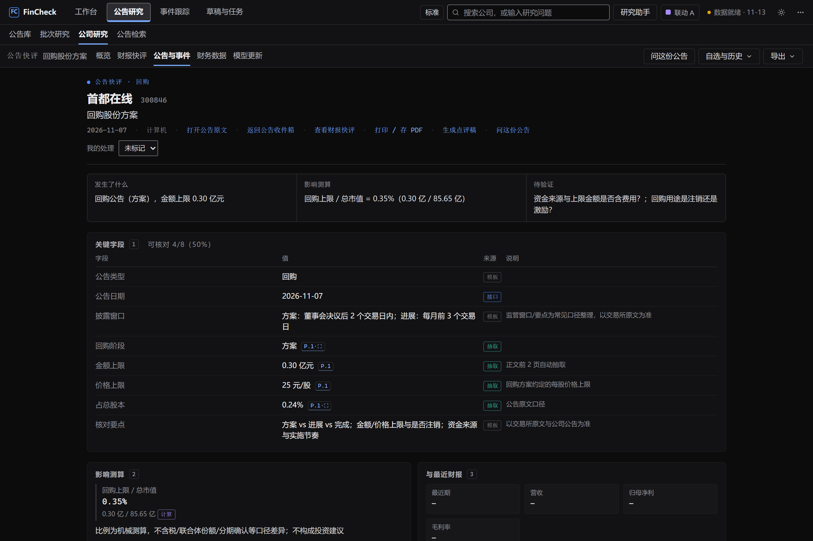
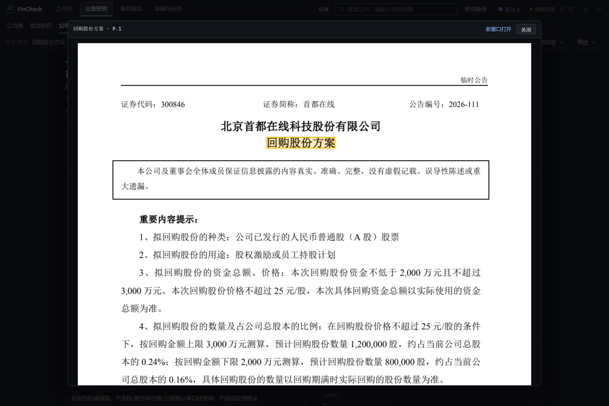
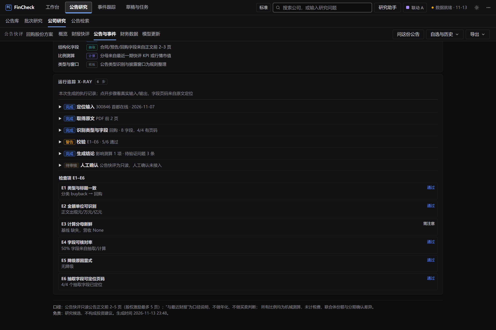
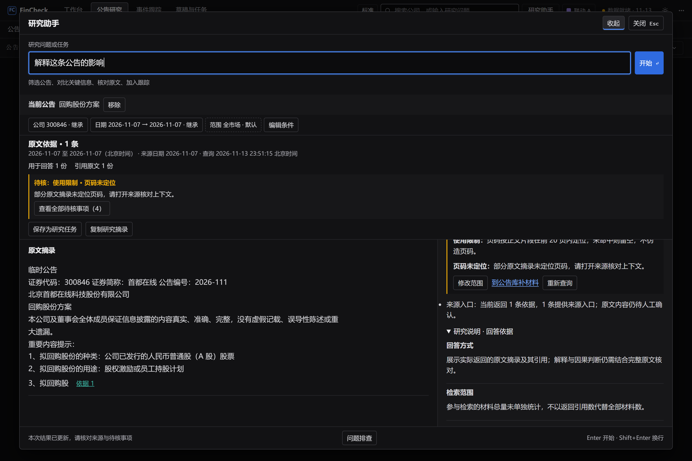

# FinCheck｜可核验的买方公告研究工作台

买方研究员在公告高峰可能要处理上百份原文和附件。FinCheck 帮他们先确定该看哪些材料，再比较关键字段、打开单份公告快评核对原文，最后把人工确认的结论送进跟踪与交付。**研究说明解释一批结果能用到哪里，公告快评提供核验单份材料的入口。** 两者贯穿同一条研究流程。

[一页纸产品说明](一页纸产品说明.md) · [返回作品集首页](../README.md) · [阅读 CRM 案例](../crm/README.md)

[项目概览](#overview) · [业务与流程](#workflow) · [研究说明](#research-explanation) · [从公告进入快评](#announcement-brief) · [复核与交付](#decisions) · [验证与后续](#value)

## 项目概览

| 项目 | 内容 |
|---|---|
| 业务背景 | 谦洵任职期间负责的内部投研工作台 |
| 核心用户 | 买方行业研究员负责筛查、比较和复核，基金经理助理整理晨会与回访事项，基金经理阅读已复核结论 |
| 我的角色 | 产品经理，负责规划、需求与流程设计、原型、交付协同及持续迭代 |
| 案例重点 | 材料如何进入研究流程、研究说明如何解释结果、公告快评怎样支持核验、研究员如何确认和交付 |
| 产品边界 | 本机研究工作台，使用公开材料和本地缓存。投资判断与研究结论由研究员确认 |

## 业务与流程

一条回购公告可能披露方案、实施进展或结果。仅看标题和金额，研究员容易把方案上限读成实际执行额，或者把多次披露的累计金额叠加。同一事件还可能带主公告、附件和更正公告。只给一张重点列表，会留下材料有没有找齐、哪些已经核过的问题。

因此，产品把**材料清单、优先级、证据和处理状态**分别管理。持仓与覆盖范围优先，低分原文和附件仍留在清单中。事件聚合减少重复阅读，独立对账仍按原始公告 ID 比较集合。对账失败时显示未知，并保留需要补查的范围。

| 研究员的任务 | 页面与产物 | 下一步决策 |
|---|---|---|
| 明确公司、日期和类别 | 公告库与研究助手显示最终查询条件、已获取文件、正文就绪情况 | 调整范围，核对缺失材料 |
| 筛选并比较一批材料 | 批次保留创建时的材料清单。队列、矩阵与异常复核共用这些文件 | 找出值得深读的公告和待核字段 |
| 核对单份公告 | 公告快评并列展示事件事实、影响测算和待验证问题，字段可回原文 | 判断金额、单位、阶段和计算口径能否采用 |
| 形成并交付结论 | 批次复核记录人工结论与理由，审核绑定具体结果 | 确认、带理由忽略或转入跟踪 |
| 继续研究 | 跟踪事件节点，或保存最终条件用于重跑 | 对比可核定的材料变化，安排下一次核验 |

## 研究说明如何解释一批结果

早期界面直接展示工具名、原始参数、命中数和执行状态。研究员看到请求成功，仍需要自己判断命中的是标题、正文还是引用，也要推断缺口会不会影响结论。产品把这些执行记录移到按需打开的「问题排查」，在结果旁提供研究员做判断所需的信息。

| 信息放在哪里 | 展示内容 | 这样安排的原因 |
|---|---|---|
| 结果摘要 | 最终范围、匹配与正文统计、影响使用的缺口 | 打开结果就能判断要继续比较，还是先补材料 |
| 依据与校验 | 当前证据、待核事项、按需展开的研究说明 | 结果旁可以打开来源，核对口径、限制及下一步 |
| 问题排查 | 同次运行的技术信息，主动打开后读取 | 方便排查故障，内部任务参数按权限隐藏 |

### 场景一 · 比较回购方案与实际执行

在研究助手输入「比较 2026 年 11 月 7 日全部回购公告的金额和价格上限」，先核对系统识别的日期、类别和范围，再看比较表。本地验收样本显示 **7 份匹配文件、7 份可检索正文**。表中把方案金额与实际执行金额放在不同列，保留缺失值，右侧解释比较口径以及字段缺失、页码未定位带来的限制。

研究说明由**本次查询条件、工具结果、证据与回执**按规则生成。结果分页、说明和建立批次都关联同一次查询的材料清单。补齐正文后，重新查询生成新的结果。对于跨报告期或不同口径的数据，研究员可以先看不可比原因，再决定如何调整条件或回源核对。

### 场景二 · 标题已找到，正文还没有

另一条验收查询中，页面显示 **1,092 份匹配文件、10 份预览、0 份可检索正文**。此时可以浏览标题线索，页面会提示先补正文再做全文分析。匹配数按原始文件计算，预览数只是当前展示的条数。可检索正文要求有非空正文和全文索引，引用的文件也按原文去重。尚未统计的数据会显示「未统计」。

### 场景三 · 说出动作后，先核对对象

输入「把这条标为已读」时，研究助手先预览具体公告、当前状态和影响范围，研究说明明确显示「尚未执行」。确认后按实际回执更新，符合条件的撤销也有对应回执。图中是确认前的预览状态。

## 从公告进入快评，核对一条结论如何得来

在批次比较矩阵找到「首都在线 · 回购股份方案」，点击「核对」打开单份复核，再点「进入公告快评」。快评保留公司、公告与披露日期的上下文。首屏回答三个问题：**发生了什么、可以做什么量级测算、还有哪些问题需要核对**。研究员可以从这里打开原文、继续问这份公告，或整理点评草稿。

| 要防止的误读 | 这个样本中的界面做法 |
|---|---|
| 把计划写成已完成 | 快评明确标「方案」，把 **0.30 亿元**写成金额上限，并把实际回购进度列入后续核验 |
| 把原文数字与系统测算混用 | **25 元/股**、**占总股本约 0.24%**来自公告。**0.35%**是用图中市值口径计算的量级，页面列出 **0.30 亿 ÷ 85.65 亿** |
| 把缺失基线补成确定值 | 样本缺少财报快评基线，营收、归母净利等留空，只显示已有输入支持的市值口径测算 |
| 把模板当作公告事实 | 字段标明抽取、接口或模板，测算单独标为计算。披露窗口和核对要点注明模板来源 |
| 把有引用当成已审核 | 可定位字段提供页码，具有页内坐标的字段可高亮原文。最终人工判断回到复核和交付流程 |

打开「回购阶段」旁的页码，应用内 PDF 阅读器高亮原文标题「回购股份方案」。同一页还能读到 **2,000 万至 3,000 万元**的方案区间及价格上限。这个来回核对能看到快评中的 **0.30 亿元**是原文区间上限，以及原文为何仍以实际使用的资金总额为准。

快评底部的运行追踪保留该次生成的真实执行记录。这个样本的分母检查标为「需注意」，因为财报基线缺失。字段可核对比例描述字段来源构成，抽取字段页码定位只覆盖本次取得的字段。人工确认状态也单独显示，便于研究员知道接下来应在哪里复核。

### 带着这份公告继续追问

在快评点击「问这份公告」，研究助手继承公告对象、公司和日期。这个样本显示 **用于回答 1 份、引用原文 1 份**。结果用实际返回的原文摘录支撑回答，并提示部分摘录页码未定位。研究员可以打开来源核对完整语境。快评中的结构化字段和追问中的摘录各有自己的定位依据，页码状态分别展示。

### AI 在哪里，约束落在哪里

- **快评先形成有依据的底稿。** 系统按公告类型读取有限页数，抽取阶段、金额、价格与比例，按规则计算可复核的指标。缺正文、缺页码或缺分母时，保留提示和核查入口。
- **追问从当前公告出发。** 「问这份公告」携带公司、日期和公告对象进入研究助手。其解释路径默认检索本地材料并给出原文摘录，证据不足时提示补齐或缩小问题范围。
- **文字增强有明确入口和回退。** 已有问答或润色路径可在适用条件下使用模型。生成结果受数字、引用和结构约束，校验失败可以回退到原文摘录或原稿。具体语义仍由研究员核验。
- **人工决定进入交付。** 快评提供研究候选与核验线索。研究员在对应复核流程中写下结论和理由，系统按当前有效审核状态决定交付内容。

本例验证了从批次打开快评、读取结构化字段并进入原文的路径。截图中的数据和测算来自隔离验收样本。

## 批次复核、跟踪与交付

### 把一次筛选变成可继续的批次

需要完整处理材料时，研究员从同次匹配清单建立批次。批次冻结公司、日期和文件 ID，暂停后可继续未完成任务，失败项保留并可重试。矩阵适合并排比较字段，异常复核用来处理缺字段、计算项及证据缺口。已读、可检索、字段已抽取和人工已确认各有自己的状态。

### 让人工确认有具体对象

单份复核同时提供抽取字段、原文页码、研究结论和复核说明。研究员确认的是这一次结果。相关材料或结论发生变化后，旧审核失效，撤回的结论也从已确认摘要退出。正式批次导出要求每份材料已确认或有理由忽略，待核内容仍可随草稿保留。

### 用不同入口承接后续研究

需要持续关注同一事件时，可以转入跟踪，按日期回访，并核对新公告与原事项的关系。需要重复筛选一类材料时，可以保存最终条件。固定日期保留原区间，滚动日期按重跑日计算。双方材料集合完整且覆盖范围可比时，系统才展示可核定的新增与消失。晨会稿、点评稿及导出物保留来源和当前审核状态，供下一位读者回查。

## 验证与后续

| 验证对象 | 已有证据 |
|---|---|
| 本次界面核对 | 实际打开回购比较与研究说明，核对正文缺口、状态预览、批次矩阵和单份复核。另从批次进入公告快评，查看字段、测算与缺失基线，打开带高亮的公告原文，并继续追问以核对上下文、摘录及页码限制 |
| 批次工作量 | 一次隔离验收覆盖 150 份原始文件，其中 146 份正文可检索，4 份缺口显式保留，150 份均处于待人工复核 |
| 工程检查 | 项目记录包含 803 项 Python 回归、33 项导航检查、32 项研究助手流程检查。研究说明另有 19 项浏览器专项检查，覆盖计数、缺口、按需诊断与操作回执 |

下一阶段用规模和难度相近的真实研究任务观察研究员能否**说清范围、解释材料缺口、指出结论适用条件，并找到下一步核验入口**。同时记录原文核验成功率、主动研究耗时、重要遗漏和返工。用户试用与独立语义评测仍待开展。

### 资料依据

FinCheck 产品需求文档，以及研究说明与诊断分层、工作区导航、系统验收和研究员试用记录。

*截图取自运行中的界面与隔离验收数据。整屏原图为 2880 × 1920 PNG，点击图片可查看大图。*

[查看一页纸产品说明](一页纸产品说明.md) · [返回作品集首页](../README.md)
