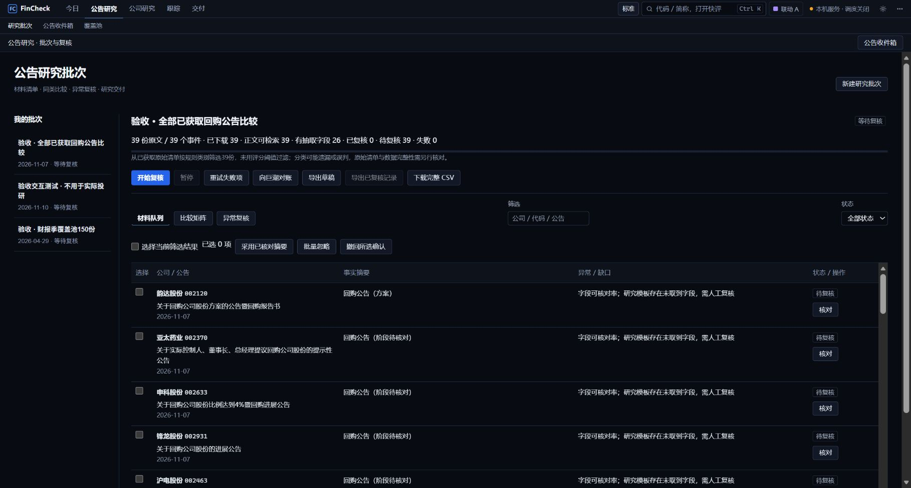
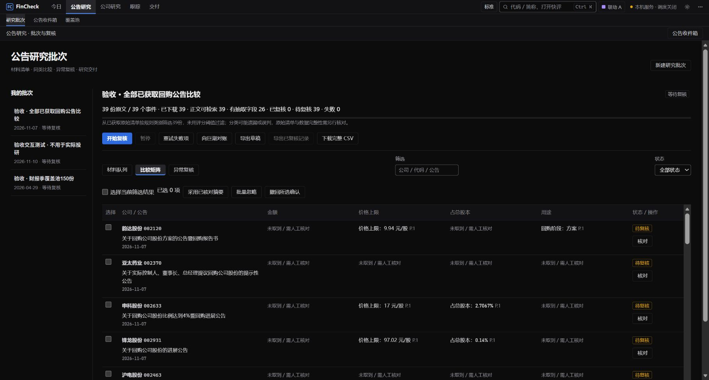
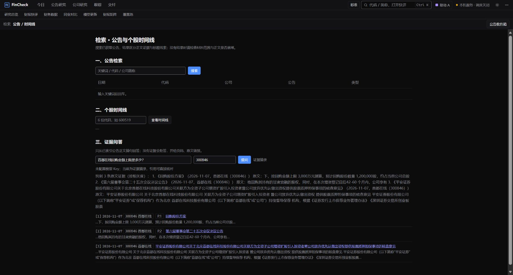
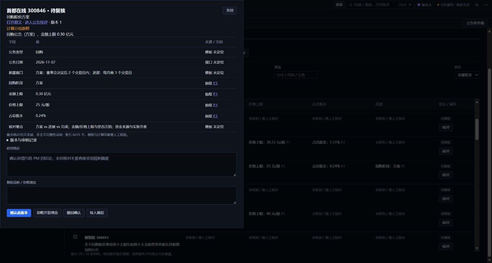
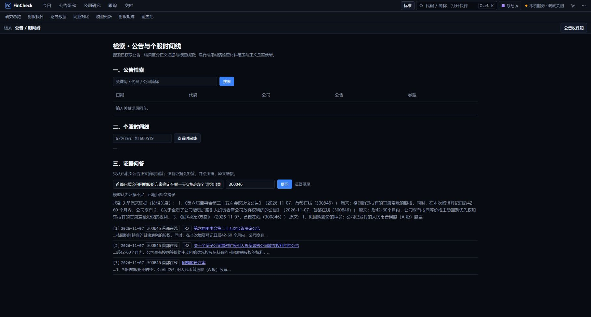
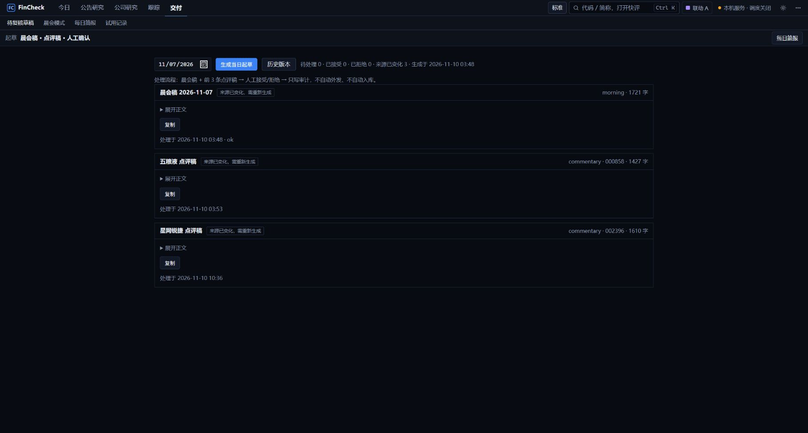

# FinCheck｜公告批量研究与证据核验

> 面向买方研究员，将大量公告的材料整理、批量比较、证据核验、读后结论与后续跟踪连接为可回查的研究流程。

[返回作品集首页](../README.md) · [阅读 CRM 案例](../crm/README.md)

**快速导航：** [项目概览](#overview) · [业务与流程](#workflow) · [三个核心决策](#decisions) · [价值与反思](#value) · [深入阅读](#details)

<a id="overview"></a>

## 项目概览

| 项目 | 说明 |
|---|---|
| 业务背景 | 浙江谦洵私募基金管理有限公司内部投研工作 |
| 核心用户 | 买方研究员；基金经理及助理消费研究结论 |
| 我的角色 | 产品经理，负责规划、需求与流程设计、原型、交付协同和持续迭代 |
| 交付情况 | 在任职期间交付，并根据研究员反馈持续迭代至离职 |
| 产品主线 | 材料收齐与分流 → 批量研究 → 证据核验 → 审核交付 → 后续跟踪 |
| AI 能力 | 基于公告证据片段的问答、已有事实稿润色，配合引用校验、拒答及回退 |

**我希望解决的是：一批公告经过处理后，研究员能明确哪些已经核对、哪些存在缺口，以及交付结论对应什么证据。**

[](images/01-research-batch.jpg)

**看图重点：** 一批材料具有独立的清单、处理状态和交付入口。画面中的 39 份原文已下载、正文可检索，但仍有待复核材料，因此“导出已复核记录”保持不可用。

*本案例图片来自原型实际操作，保留页面中的材料日期、验收标识及待复核状态。字段抽取和模型回答用于说明核验流程，不视为已确认的研究结论。点击图片可查看大图。*

<a id="workflow"></a>

## 业务与流程

研究员既要优先阅读重要事件，也要知道覆盖范围内的公告和附件是否处理完整。FinCheck 将材料、证据、人工结论和后续事项组织为连续任务，服务研究准备与核对，不负责交易执行。

我负责将研究任务拆分为清单、优先级、批次比较、证据核验、审核和交付跟踪，完成流程与原型设计，协同研发交付，并根据研究员反馈持续迭代。

| 步骤 | 用户动作 | 产品如何支持 |
|---|---|---|
| 建立清单 | 选择日期、覆盖范围和研究模板 | 保留每份原文与附件，冻结批次范围，展示完整性状态 |
| 分流排序 | 优先看持仓、覆盖公司及重要事件 | 排序决定先看什么，原始材料仍保留 |
| 比较材料 | 在队列、矩阵和异常视图中阅读 | 同类字段并排比较，缺失和失败明确呈现 |
| 核验证据 | 查看字段出处或提出问题 | 按公司、日期和问题检索证据，支持原文回查 |
| 作出判断 | 修改结论、确认或有理由忽略 | 记录人工意见，审核绑定具体结果版本 |
| 交付跟踪 | 输出研究材料并建立后续事项 | 使用当前审核状态，保留来源、版本和下一步 |

<a id="decisions"></a>

## 三个核心决策

### 决策一：完整材料与研究进度分别管理

**问题：** 重点榜单容易隐藏其余材料，而下载或解析完成也不能说明研究已经结束。

**选择：** 重点排序决定先看什么，完整清单保留每份公告与附件。正文可检索、字段抽取、人工复核分别计数；失败保留并可重试，缺字段明确展示。

**取舍：** 增加范围与状态管理，让用户能区分“已经获取”“已经解析”和“已经核对”。外部对账失败显示未知，事件聚合不减少原文清单。

[](images/02-comparison-matrix.jpg)

**从截图读设计：** 研究员可横向比较相同字段，已抽取值携带页码，缺字段明确显示“未取到 / 需人工核对”。缺失不填成零，解析成功也不自动改变人工复核状态。

### 决策二：证据约束问答，并提供失败回退

**问题：** 回答附了链接，也可能引用错公司、错期间，或将计划中的金额写成已完成事实。

**选择：** 先限定公司、日期和证据片段，再生成回答。核对引用编号、精确数字、单位及部分主体、期间和方向规则；证据不足拒答，校验失败回退原文摘录。

**取舍：** 允许系统少回答一些，也保留用户继续核查的路径。规则校验覆盖有限，引用命中不能直接代表语义正确，最终判断仍由研究员完成。

[](images/04-evidence-answer.jpg)

**从截图读设计：** 对“回购金额上限”的问题，页面给出带引用的回答，并将公告标题、页码与对应片段放在下方。“已校验引用与数值，语义仍需复核”明确区分程序校验与研究员判断。

### 决策三：人工审核与交付版本一致

**问题：** 用户确认后，来源、字段或笔记仍可能变化。如果旧确认持续有效，导出物就可能与用户真正审核过的内容不同。

**选择：** 结果保留版本和来源信息；相关变化使旧审核失效。导出读取当前审核快照，删除或拒绝的结论不能重新进入交付物。

**取舍：** 部分修改需要重新核对，但确认行为具备明确对象。正式批次交付要求材料已确认，或已由人工填写理由忽略；其余以草稿及缺口表达。

[](images/03-evidence-review.jpg)

**从截图读设计：** 复核面板区分模板与抽取字段，给出来源页码和结果版本。研究员填写结论与复核说明后，再选择“确认此版本”、忽略或转入跟踪；当前画面仍为待复核。

<a id="value"></a>

## 价值与反思

产品将材料处理、证据核对和结论交付连接起来。已有记录覆盖批次运行、检索、状态撤销和导出一致性；这些证据说明具体流程与测试范围，真实研究效率和广泛语义质量仍需进一步验证。

**分工原则：** 程序处理清单、计算和状态，模型处理有证据的语言任务，研究员判断影响并确认结论。引用正确、数字校验通过，都不能单独证明研究结论正确。

评价效果时同时看**主动耗时、重要遗漏、字段错误和返工**。后续重点是独立新样本的语义评估与真实任务观察，再根据失败类型决定是否增加重排、数据源或自动化能力。

<a id="details"></a>

## 深入阅读

以下材料用于进一步查看失败处理、模型分工和验证范围。

<details markdown="1">
<summary>证据不足时如何回退（补充截图）</summary>

[](images/05-insufficient-evidence.jpg)

**从截图读设计：** 追问具体实施完成日期时，页面提示“模型认为证据不足，已退回原文摘录”。这次操作展示的是停止生成确定答案、保留核查路径；摘录中仍有同公司其他事项，说明召回相关性还需要进一步评估。

</details>

<details markdown="1">
<summary>来源变化后如何阻止旧稿继续使用（补充截图）</summary>

[](images/06-review-invalidated.jpg)

**从截图读设计：** 晨会稿与点评稿出现“来源已变化，需重新生成”，复制操作不可用。审核约束延伸到了交付阶段，避免旧结论继续被当作有效材料使用。

</details>

<details markdown="1">
<summary>规则、检索、模型与研究员的详细分工</summary>

| 层级 | 负责的工作 | 关键约束 |
|---|---|---|
| 规则与程序 | 清单、分类与排序、PDF/OCR、字段处理、单位换算、计算、状态和导出 | 未知与零值分开；批次解析主要采用规则和模板 |
| 检索 | 从公告标题和正文片段中寻找相关证据 | 公司、日期和材料范围明确；基础召回采用词匹配及同义扩展，可选重排 |
| 大模型 | 基于证据回答问题，对已有事实稿进行语言润色 | 输出携带引用；不直接修改事实库、投资假设或外发内容 |
| 校验与回退 | 检查输出结构、引用、数值和部分语义条件 | 失败保留错误原因与原文摘录；无模型时提供抽取式结果 |
| 研究员 | 核实证据、判断影响、修改结论和确认交付 | 确认对应版本，材料不足可继续补充或保留待核 |

证据问答的基本路径：

```text
研究问题
  → 识别公司、日期与任务范围
  → 检索公告片段
  → 有足够证据：生成带引用回答 → 校验 → 人工核对
  → 证据不足：说明缺口并拒答
  → 输出校验失败：回退原文摘录，保留核查路径
```

润色同样保留原稿：数字和结构校验通过，并不证明每个措辞都忠实于原意。因此，润色结果需要可对比、可回退，而不能直接覆盖已核对事实。

</details>

<details markdown="1">
<summary>验证记录与效果评估方法</summary>

### 已有验证记录

下表摘自 PRD 的验收基线。数据用于说明具体测试覆盖，不作为历史经营收益或整体研究准确率。

| 验证对象 | 记录结果 | 支持的结论与范围 |
|---|---|---|
| 批次处理 | 150 份原文、131 个事件；146 份正文可检索，4 份缺口保留 | 批次流程和缺口表达可运行；材料仍待人工复核 |
| 工程回归 | 657 项测试通过，3 项警告 | 已有测试集通过，不等于语义准确率 |
| 界面与交互 | 38 个页面/视口场景通过 | 已测场景的布局与交互结果，不外推全部设备 |
| 检索回归 | 23/23 原公告引用命中 | 单日、已用于调试的回归题集；不等于字段正确或独立盲测结果 |
| 真实模型调用 | 合同金额及主体问题作答，未披露日期问题拒答，共 2 例 | 验证有限的作答和拒答路径，不推导总体准确率 |
| 状态一致性 | 2,695 条状态写入及撤销通过；导出核对编辑、删除和拒绝结果 | 验证数量与审核快照一致性，不证明全部财务语义 |

### 产品效果如何衡量

**目标是减少主动处理时间，同时保持重要信息和结论质量。**

- **效率：** 主动耗时、找数和跨页操作、PDF 打开次数；软件内活动计时与其他工具中的工作时间分别记录。
- **质量：** 重要遗漏、字段错误、返工结论，以及数值、单位、主体、期间和状态的一致性。
- **体验：** 独立完成任务、人工核验负担，以及是否愿意在后续研究中继续使用。
- **模型表现：** 正确作答、合理拒答、错误作答和错误拒答分别观察；引用命中与答案正确分开评估。

对照应使用规模和类型接近、内容不同的材料，并同时检查时间和质量。独立新样本与修复用回归集分开，避免把熟悉材料或反复调试带来的改善误认为泛化能力。

本文不填报尚无可核实测量依据的研究员提效百分比；真实效率与广泛语义质量仍需进一步验证。

</details>

<details markdown="1">
<summary>批次范围、恢复机制与问答路由</summary>

**问题：** 每日必读可以帮助聚焦，但只展示 Top5 或 Top20，容易让使用者误以为其余材料无需处理。

**选择：** 重点列表作为优先阅读视图，完整批次保留原始公告和附件。事件聚合只减少展示行数，不减少原文清单；对账按日期、公司范围和原始 ID 核对。

**取舍：** 增加范围与缺口管理，但用户能够区分“优先看过”与“范围内已处理”。外部查询失败时显示未知，不能把部分查询成功当成完整。

### 批次状态与恢复

**问题：** 下载成功、文本可检索、字段抽出和结论正确，是不同层级。一个统一进度条容易隐藏差异。

**选择：** 分别展示原文数、正文索引数、字段结果、失败数和人工复核数。解析完成进入待复核；失败保留在队列中，可仅重试失败项。

**取舍：** 状态更细，但能阻止“批次跑完即研究完成”的误解。暂停停止领取新任务，允许在途结果写回；恢复后继续未完成项。


### 按任务选择交互

**问题：** “这份公告的合同金额是多少”和“完整整理今天全部回购公告”对材料覆盖的要求不同。少量检索片段无法支持后一种穷尽式任务。

**选择：** 具体证据问题进入问答；涉及完整范围、同类比较的任务引导至带范围和模板的批次视图。异常处理保留原工作上下文。

**取舍：** 用户会在问答和工作台之间切换，但输出形式与任务完成标准更一致。

</details>

<details markdown="1">
<summary>业务拆解、职责与后续重点</summary>

### 业务问题

研究员需要持续跟踪覆盖公司，处理公告和附件，核对金额及财务口径，再判断是否影响已有假设，并向基金经理汇报。工作中既有重点阅读，也有完整材料处理，不能只依靠少量摘要。

| 研究任务 | 产品需要回答的问题 |
|---|---|
| 找到材料 | 今天应该处理哪些原始公告和附件，是否仍有缺口？ |
| 判断优先级 | 哪些值得优先深读，其他材料处于什么状态？ |
| 核对事实 | 数字来自哪一页，主体、单位、期间和表述是否一致？ |
| 形成结论 | 研究员确认了什么，哪些只是待验证问题？ |
| 交付与跟踪 | 晨会稿是否使用最新结论，后续事项由谁继续处理？ |

FinCheck 围绕这些连续任务设计工作台。财务数据和原文来源为研究提供基础，产品的重点是组织处理过程、证据和读后结论。

### 职责与范围

我将研究任务拆分为材料清单、优先级、批次比较、证据核验、人工审核和交付跟踪，完成流程与原型设计，并协同研发推进交付和迭代。

核心产品工作包括：

- 建立材料队列、比较矩阵和异常复核之间的任务关系，定义暂停、恢复、重试与缺口保留。
- 设计公告证据问答和事实稿润色，明确模型输入、输出、引用及失败行为。
- 划分规则计算、模型辅助与研究员判断的职责，设计审核失效、版本管理和导出条件。
- 将快评、晨会稿、研究笔记和跟踪事项连接起来，根据使用反馈调整操作流程。

产品定位为公告研究工作台，服务研究准备与结论核对；不负责交易执行或自动给出买卖决策，也不以建设完整商业数据终端作为范围目标。

### 后续重点

**第一，可信体验贯穿整个任务。** 一条引用只是起点，还需要范围、缺口、人工意见和导出版本一致。

**第二，增加模型调用不一定优先解决问题。** 单位、合同主体、期间和状态错误，可以先通过数据契约、明确字段及确定性校验减少；模型更适合有证据约束的语言任务。

**第三，用户应当能继续完成工作。** 无模型、下载失败、缺正文或校验不通过时，需要保留已完成结果、原文入口和恢复路径。

后续优先验证多日独立样本的字段及语义质量，并采集真实任务中的耗时、遗漏和返工。是否增加语义重排、数据源或更多自动化能力，应依据具体失败类型与用户负担决定。

</details>

<details markdown="1">
<summary>内容依据</summary>

《FinCheck · 公告批量研究与读后结论工作台 · 产品需求文档》v7.1，重点参考第 6.8–6.11、7、10.5 章及 F01–F30 验收说明。“验证记录”中的批次、测试及探针数字摘自原记录，图文整理未重新执行全量验收；问答与证据不足回退截图来自实际页面操作。

</details>

---

[返回作品集首页](../README.md) · [阅读 CRM 案例](../crm/README.md)
