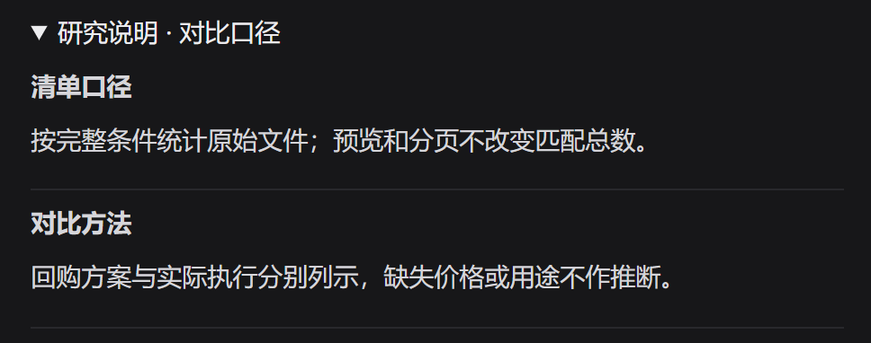
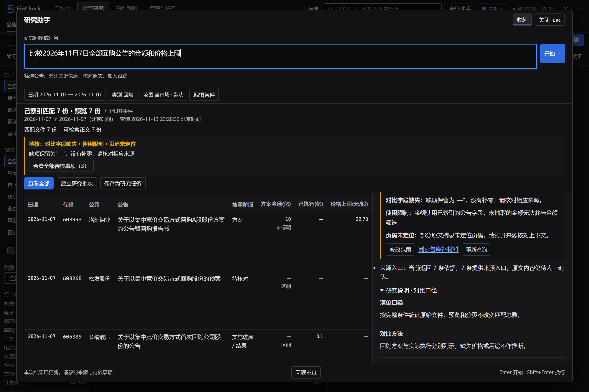
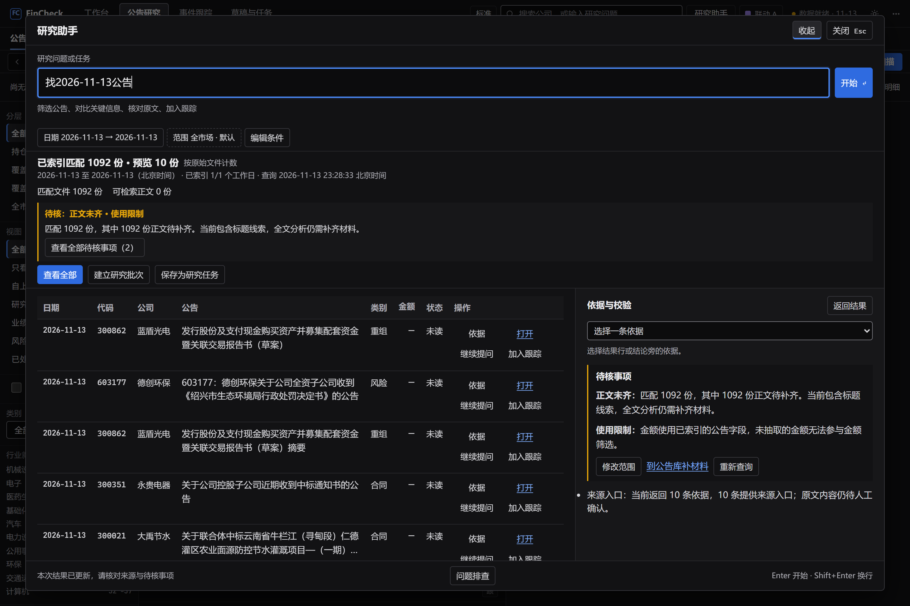
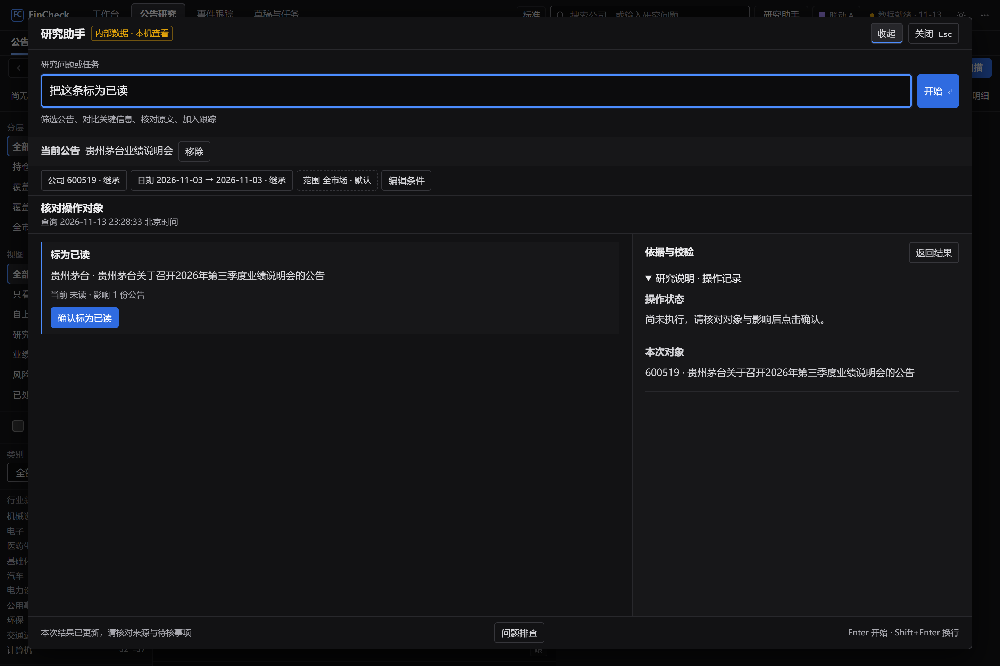
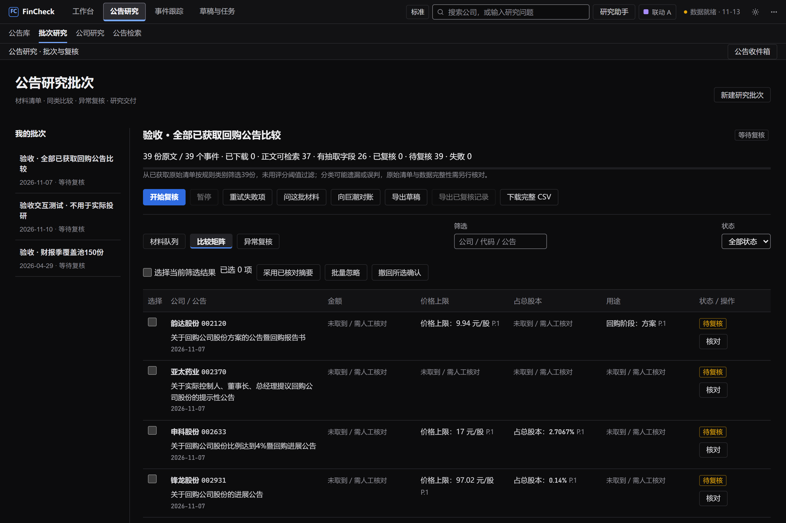
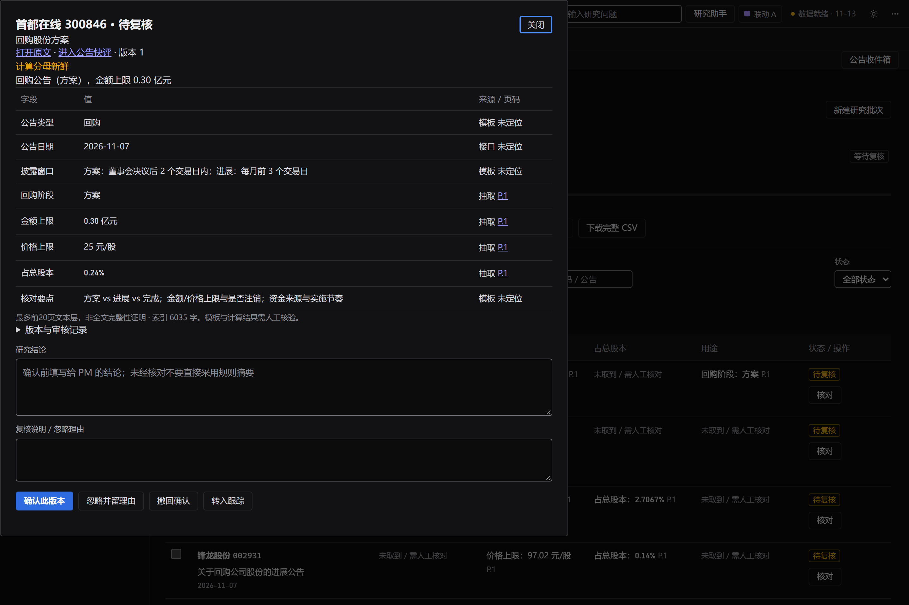

# FinCheck｜可核验的买方公告研究工作台

面向每天处理大量公告的买方研究员。FinCheck 把材料范围、批量比较、原文证据、人工结论和后续动作放到同一条流程里。**「研究说明」让研究员知道本次结果可以用到哪里，以及怎样继续核对。**

[一页纸产品说明](一页纸产品说明.md) · [返回作品集首页](../README.md) · [阅读 CRM 案例](../crm/README.md)

[项目概览](#overview) · [业务与流程](#workflow) · [研究说明](#research-explanation) · [三个核心决策](#decisions) · [验证与后续](#value)

## 项目概览

| 项目 | 内容 |
|---|---|
| 业务背景 | 谦洵任职期间负责的内部投研工作台 |
| 核心用户 | 买方行业研究员，基金经理助理参与整理与跟踪，基金经理阅读已复核结论 |
| 我的角色 | 产品经理，负责规划、需求与流程设计、原型、交付协同及持续迭代 |
| 本案例展示 | 研究助手、研究说明、公告批次与人工复核 |
| 当前产品边界 | 本机研究工作台，使用公开材料和本地缓存，研究判断与确认由人负责 |

## 业务与流程

公告高峰可能涉及上百份原文和附件。研究员既要快速找到重要变化，也要弄清自己看过哪些材料、哪些还缺正文、哪些数字可以放在一起比较。最后交给基金经理的结论还需要能回到来源和审核版本。

**明确范围 → 获取与对账 → 分流筛选 → 批量比较 → 查看研究说明与证据 → 人工确认 → 跟踪与交付**

研究助手可通过顶栏、Ctrl+K 或「问这份公告」「问这家公司」「问这批材料」发起。系统显示可编辑的公司、日期、类别和范围等条件。复杂或需要完整处理的任务可以按同次匹配清单建立批次，研究员也可保存最终条件用于跨日重跑。

## 核心功能 · 研究说明

输入「比较 2026 年 11 月 7 日全部回购公告的金额和价格上限」后，结果显示日期与类别，列出本地索引匹配的文件。矩阵把方案金额和已执行金额分列，右侧展开「研究说明 · 对比口径」。缺字段或页码未定位时，用户可以打开来源核对，或调整范围、补材料后重查。

*点击局部图可查看完整界面。截图使用隔离验收数据，整屏原图为 2880 × 1920 PNG。*

| 界面层级 | 研究员看到什么 |
|---|---|
| 结果摘要 | 当前范围、适用的材料统计、关键缺口与查看全部结果的入口 |
| 依据与校验 | 当前证据和待核事项可见，按需展开研究说明。根据任务呈现范围与材料、对比口径、回答依据或操作记录 |
| 问题排查 | 用户主动打开时才读取同次运行的技术诊断。公开任务仅展示允许的参数，内部任务隐藏参数 |

### 先弄清这次有哪些材料可用

在另一条验收查询中，系统匹配了 **1,092 份文件，预览 10 份，可检索正文 0 份**。这些数字分别表示同次查询匹配的原始文件、当前显示的预览、已保存非空正文且有全文索引的文件。此时系统提示正文待补齐，研究员可以到公告库补材料再重新查询。

回答用到的原文文件、引用文件也各自统计，同一原文的多段摘录仍算一份文件。参与检索的全量材料当前未单独统计。分页、说明和批次清单按同次结果关联，补齐正文后重新查询才会得到新的结果。正文可检索只代表文本已就绪，仍需核对具体页、字段和上下文。

### 操作说明跟随实际状态

输入「把这条标为已读」时，界面先展示具体公告、当前状态和影响范围，研究说明显示「尚未执行」。用户核对并确认后，系统以回执更新说明。符合条件的撤销也有对应回执。截图展示的是确认前预览。

## 三个核心决策

### 把研究说明做成结果的使用依据

把研究员能核对的范围、材料统计、口径和限制放到摘要与依据区，技术诊断留在单独入口。说明从本次查询条件、工具结果、证据和回执按规则生成。研究助手的解释路径默认采用本地检索和原文摘录。可选模型解析仅用于符合条件的公开任务，需配置并显式启用。

### 用冻结批次保留完整工作量

重点排序用于分流。研究批次冻结公司、日期与原始文件，材料队列、比较矩阵和异常复核使用同一清单。下载、可检索正文、字段抽取、人工复核分别计数，失败保留在待处理清单并可重试。

### 让确认、跟踪与交付有据可查

研究员可以打开原文、核对页码与口径、写下结论并确认具体版本。后续修改会使旧审核失效。已确认摘要读取当前有效审核版本，正式批次导出要求每份材料已确认或有理由忽略。事件跟踪和保存任务承接后续研究。

## 验证与后续

本次在隔离验收数据上检查了对比口径、正文覆盖缺口、待执行预览、批次矩阵和单份复核。项目发布记录包含 **803 项 Python 回归、33 项导航检查、32 项研究助手流程检查**。研究说明专项记录包含 **19 项浏览器检查**，涵盖材料统计、待核事项、诊断按需打开和操作回执。

下一阶段以真实研究任务测量**说明理解正确率、原文核验成功率、主动研究耗时、重要遗漏及返工**。观察研究员能否说清本次范围、缺什么、结果适用到哪里，以及接下来去哪里核对。真实研究员试用仍待开展。

### 资料依据

FinCheck 产品需求文档，以及研究说明与诊断分层、工作区导航的发布验证记录。

[查看一页纸产品说明](一页纸产品说明.md) · [返回作品集首页](../README.md)
