# FinCheck｜可核验的买方财报与公告研究工作台

买方研究员既要快速读懂一份财报，也要能把判断追回到报告期、原文和计算口径。FinCheck 把这两个任务放在相连的界面里。**财报快评**把关键变化、异常、待回答问题和证据摆在一起。**研究问答**让研究员带着公司上下文继续追问，也能扩大范围比较一组公告。

**我的职责**　谦洵投研工作台的产品经理，负责产品规划、需求与流程设计、原型、交付协同和迭代。

[看财报快评](#financial-brief) · [看研究问答](#research-explanation) · [看校验与回退](#ai-workflow) · [一页纸产品说明](一页纸产品说明.md)

## 财报快评｜先判断变了什么，再决定到哪查

在「公司研究 → 财报快评」打开贵州茅台 2026 年三季报。页面顶端明确公司、报告期和来源覆盖。左侧先给出**本期结果、最大异常、待回答**，再把营收、归母净利润和扣非净利润按单季、累计分列。右侧并列放证据、PDF 原文、预期与证据链、运行追踪。研究员可以从快评看全局，再就地打开对应事实的出处。

[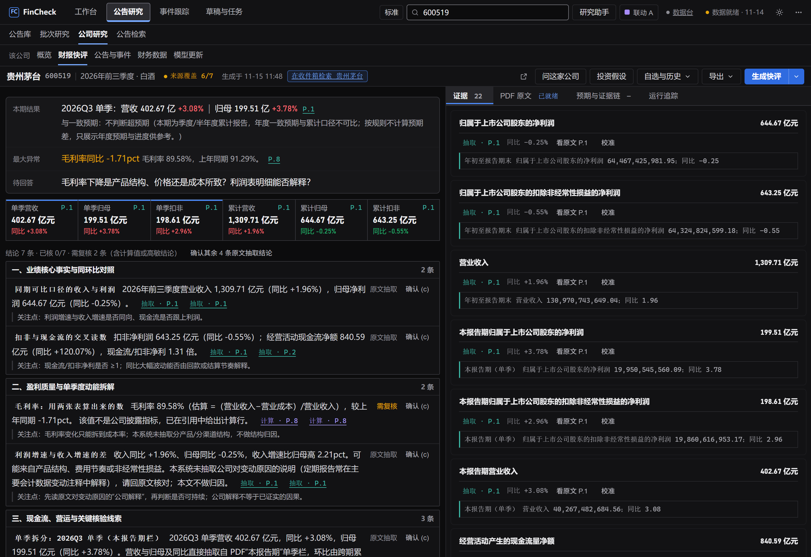](images/31-financial-brief-overview.png)

| 研究员要判断什么 | 页面如何帮他判断 |
|---|---|
| **这个数字属于哪一期** | 样本的单季归母净利润为 **199.51 亿元，同比 +3.78%**，前三季度累计为 **644.67 亿元，同比 −0.25%**。两组数据并列标明期间和页码，让方向变化一眼可见。 |
| **异常值得追查什么** | 毛利率 **89.58%** 标为按公式估算的指标，较上年同期下降 **1.71 个百分点**，带出结构、价格或成本待查问题。下方按业绩事实、盈利质量、现金流和营运线索分组，计算值保留依据和复核标记。 |
| **能否判断超预期** | 本例可用的是季度与累计业绩，年度一致预期仅作进度参考。页面将该口径标为「不判断超预期」。 |

从右侧证据点「看原文 P.1」，可在同一页打开报告，并保留左边的结论和指标。研究员可以对照 PDF 表里的「本报告期」与「年初至报告期末」，再决定采用哪一个数字。图中证据卡的金额为亿元，原文保留披露单位。

[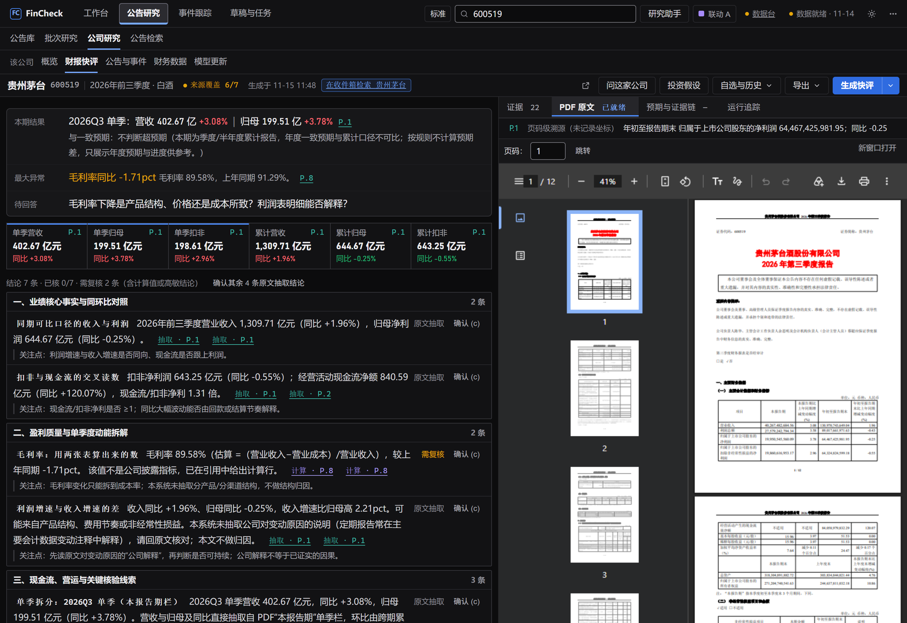](images/32-financial-brief-pdf.png)

## 研究问答｜带着公司上下文追问，也能比较一组材料

**围绕财报追问。** 从快评点「问这家公司」，研究助手继承公司代码 600519。输入「解释贵州茅台 2026 年三季报营业收入和归母净利润的变化」。上方显示可编辑的查询条件，左侧返回已有的研究结论、指标和逐条依据，右侧展示所选证据的公司、报告期、原文摘录和页码。选择「依据 1.1」，可以核对累计营收对应三季报第 1 页，并继续从「打开原文」检查。

[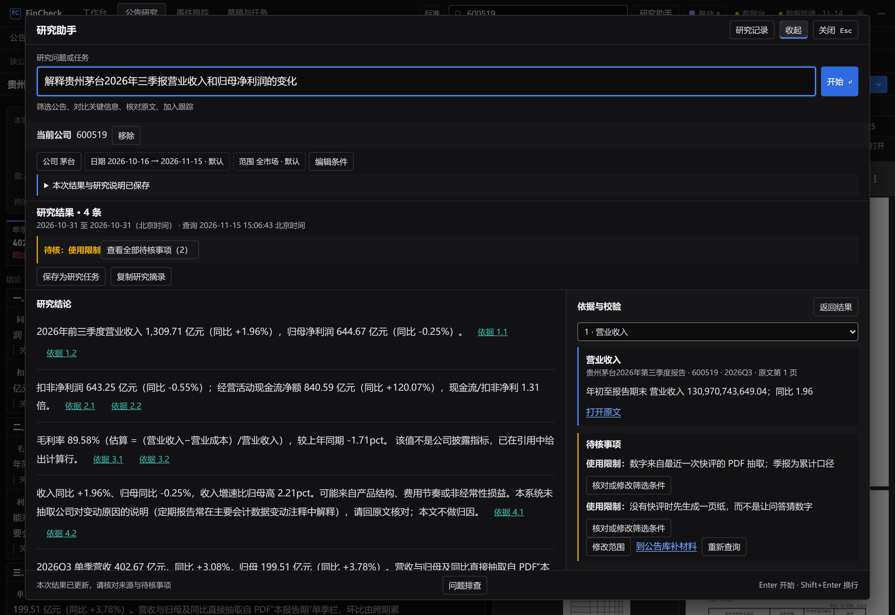](images/33-financial-question.png)

这个样本复用的是该公司的财报快评及其 PDF 抽取依据。收入和利润的变化可回查原表，产品结构或费用节奏在页面保留为待查线索，具体原因由研究员回到公告核验。可用证据不足时，界面给出当前限制及查原文、改条件或补材料的入口。

**扩大范围做比较。** 输入「比较 2026 年 11 月 7 日全部回购公告的金额和价格上限」，研究助手将问题拆成日期、类别和范围。隔离样本匹配 **7 份公告，7 份正文可检索**。左侧将披露阶段、方案金额、已执行金额和价格上限分列，右侧可预览所选公告的来源。缺字段保留「—」。用户可查看完整结果、建研究批次或保存任务，并从本次清单补材料后重新查询。

[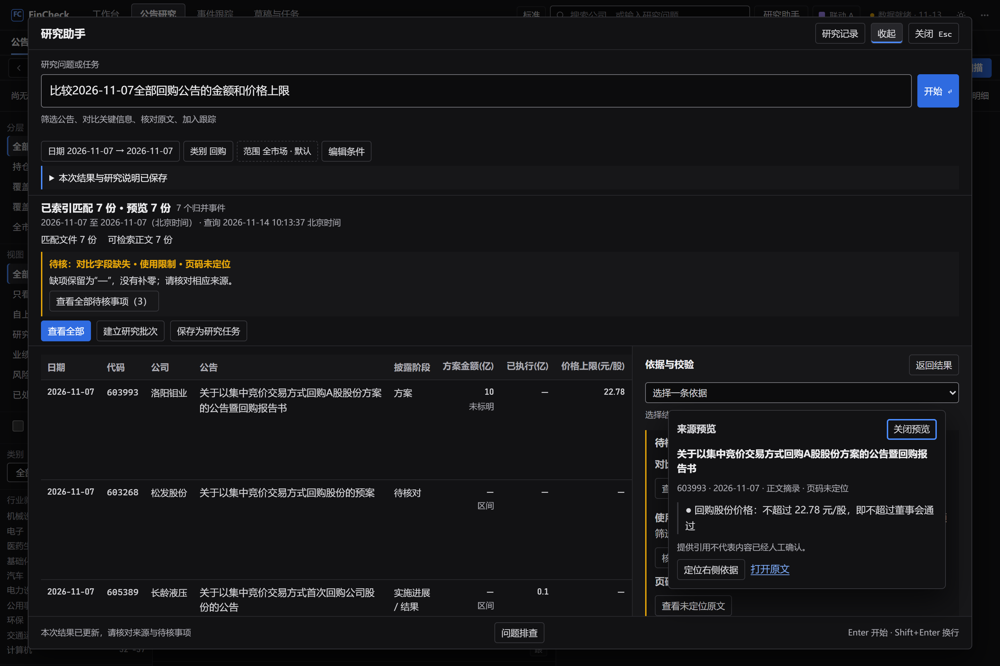](images/10-source-preview.png)

## AI 校验与回退｜让错误回答有可核对的退路

上面的财报问答使用本地已取得的事实与证据。独立的可选证据问答和草稿润色可接入模型，证据问答检查引用、数值及状态，润色回查原稿和编号事实。研究助手也可以在已配置且获用户允许的公开低置信任务中，用模型辅助解析条件。研究员通过依据核对业务含义，并确认下一步动作。

另用首都在线的单条回购公告做了本地回退演练。构造的回答把「拟回购」写成「已完成」，即使引用和数值能对上，也会因实施状态与原文不一致被拦截。允许修正一次后仍未通过，系统返回可回查的原文摘录。演练验证了校验与回退，外部模型效果另行验证。 [查看公告快评的 X-Ray 检查记录](images/26-xray-four-states.png)

## 核对之后，怎样把决定带到下一次研究

在隔离晨会样本中，研究员对首都在线回购方案选择**跟踪回购进度**。刷新后决定仍保留，生成的纪要记录「会上决定：跟踪」。系统建立了 **12 月 7 日**的回访事项，让研究员届时核对已回购金额、股数和价格上限变化。

[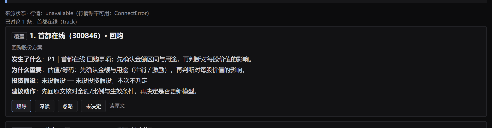](images/29-morning-research-decision.png)

案例截图采用公开披露和隔离样本。晨会改决定后复制旧纪要、跨日切换和历史回放仍待单独验证。

## 展开过程证据

可按需展开单条公告快评、批量研究、更正回溯、盘后交付和验收细节。截图均可点击查看原图。

批量研究 · 匹配口径、材料补齐、任务恢复与结果对照

一条回购公告可能披露方案、实施进展或结果。仅看标题和金额，研究员容易把方案上限读成实际执行额，或者把多次披露的累计金额叠加。同一事件还可能带主公告、附件和更正公告。只给一张重点列表，会留下材料有没有找齐、哪些已经核过的问题。

因此，产品把**材料清单、优先级、证据和处理状态**分别管理。持仓与覆盖范围优先，低分原文和附件仍留在清单中。事件聚合减少重复阅读，独立对账仍按原始公告 ID 比较集合。对账失败时显示未知，并保留需要补查的范围。

| 研究员的任务 | 页面与产物 | 下一步决策 |
|---|---|---|
| 明确公司、日期和类别 | 公告库与研究助手显示最终查询条件、真实执行进度、匹配文件和正文就绪情况 | 确认范围，判断结果是否已完成 |
| 筛选并比较一批材料 | 批次保留创建时的材料清单。队列、矩阵与异常复核共用这些文件 | 找出值得深读的公告和待核字段 |
| 核对单份公告 | 公告快评并列展示事件事实、影响测算和待验证问题，字段可回原文 | 判断金额、单位、阶段和计算口径能否采用 |
| 形成并交付结论 | 批次复核记录人工结论与理由，晨会记录议题决定并生成纪要 | 确认、带理由忽略或转入跟踪 |
| 补齐或继续研究 | 按待核事项进入明细，仅为缺正文材料建立补充批次；从研究记录恢复结果或重新查询 | 核对后开始解析，比较前后条件与材料变化，安排下一次核验 |

在「公司研究」中，概览、财报快评、公告与事件、财务数据、模型更新共用一行公司视图入口。从贵州茅台的「概览」切到「财务数据」，公司代码和导航位置保持一致，选中标记随页面切换。研究员可以在同一公司下切换任务，快速确认当前所在的视图。

[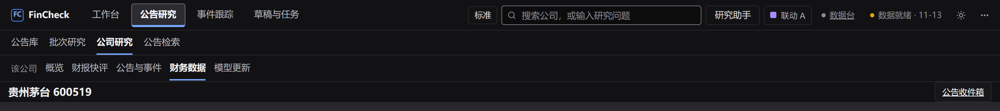](images/19-company-data-tabs.png)

早期界面直接展示工具名、原始参数、命中数和执行状态。研究员看到请求成功，仍需要自己判断命中的是标题、正文还是引用，也要推断缺口会不会影响结论。产品把内部工具参数移到按需打开的「问题排查」，在结果旁提供研究员做判断所需的信息。与此同时，把**执行到哪一步、这句依据是什么、缺什么以及如何补、与上次相比变了什么**接成可操作的研究流程。

| 信息放在哪里 | 展示内容 | 这样安排的原因 |
|---|---|---|
| 结果摘要 | 最终范围、匹配与正文统计、影响使用的缺口 | 打开结果就能判断要继续比较，还是先补材料 |
| 依据与校验 | 当前证据、待核事项、按需展开的研究说明 | 结果旁可以打开来源，核对口径、限制及下一步 |
| 问题排查 | 同次运行的技术信息，主动打开后读取 | 方便排查故障，内部任务参数按权限隐藏 |

**先确认研究实际执行到了哪里**

研究助手接收问题后，按实际执行事件展示范围确认、材料匹配、正文就绪、依据整理、说明生成与结果保存。首屏保留当前状态，研究员可以展开查看过程。**未发生的阶段不会显示，完成进度也不代表材料齐全或结论已审核。** 图中已完成匹配和保存，但正文仍是 0 份，页面继续保留补材料提示。

[查看真实执行过程截图](images/11-research-progress.png)

这一设计也处理等待中的不确定性。关闭助手后，只读研究可以继续，研究员从「研究记录」回看状态。请求停止后，系统等待当前读取结束，再以后端确认状态为准；已完成结果不会被迟到的取消覆盖。程序退出时未完成的运行会显示中断，由用户决定是否重新发起。已经发出的业务操作仍要核对原有回执。

**比较回购方案与实际执行，就近查看依据**

在研究助手输入「比较 2026 年 11 月 7 日全部回购公告的金额和价格上限」，先核对系统识别的日期、类别和范围，再看比较表。本地验收样本显示 **7 份匹配文件、7 份可检索正文**。表中把方案金额与实际执行金额放在不同列，保留缺失值，右侧解释比较口径以及字段缺失、页码未定位带来的限制。

[查看研究说明局部](images/00-research-explanation-focus.png) · [查看回购比较完整界面](images/01-research-explanation.png)

研究说明由**本次查询条件、工具结果、证据与回执**按规则生成。结果分页、说明和建立批次都关联同一次查询的材料清单。对于跨报告期或不同口径的数据，研究员可以先看不可比原因，再决定如何调整条件或回源核对。

核对某一行时，研究员可以直接在「依据」上悬停、键盘聚焦或点击预览来源，再决定是否定位右侧依据、打开完整原文。卡片提供材料名称、公司、日期或报告期、实际摘录，以及页码或缺页提示。图中洛阳钼业回购方案的价格上限为 **22.78 元/股**，预览呈现对应正文摘录，同时保留「页码未定位」和「提供引用不代表内容已经人工确认」的限制。

[查看比较结果旁的来源预览](images/10-source-preview.png)

来源卡复用本次实际取得的证据，不额外调用模型。按 Esc 只关闭预览，并回到原引用，方便继续核验下一行。**标题线索、正文摘录、结构化字段与人工确认分别表达，不把「有来源」当成「已核实」。**

**从正文缺口进入补充批次**

另一条本地验收查询显示 **1,108 份匹配文件、10 份预览、0 份可检索正文**。此时可以浏览标题线索，全文分析仍需先补材料。匹配数按原始文件计算，预览数只是当前展示的条数。可检索正文要求有非空正文和全文索引，引用的文件也按原文去重。尚未统计的数据会显示「未统计」。

点击「查看缺正文清单」，研究员看到的是这次查询快照中的具体材料，可逐项打开公告或原文，清单按同一快照分页。「建立缺正文补充批次」只收集其中待补正文的文件，不把已经就绪的材料重复纳入。

[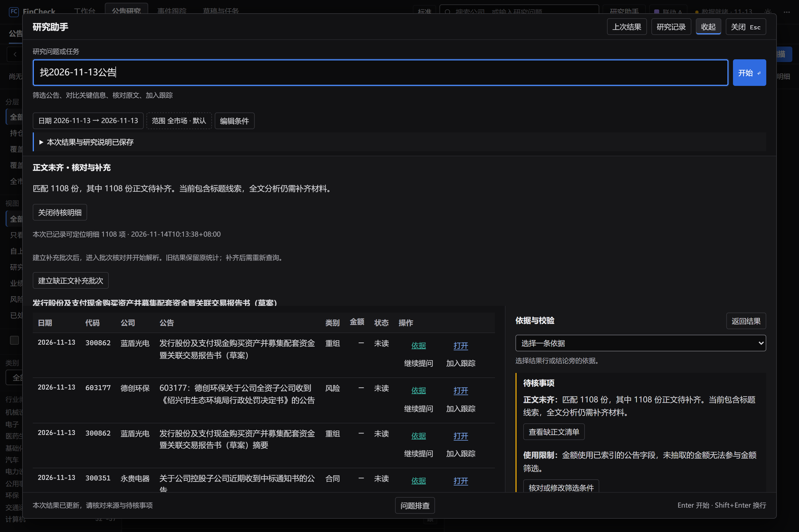](images/12-missing-materials.png)

补充批次建立后保持**暂停**，由研究员核对范围，再点击「开始／继续解析」。图中 1,108 份文件进入待解析队列，尚未执行批量解析。补齐正文后重新查询，形成新的研究结果；旧结果的材料统计保持原样。

[查看已暂停的缺正文补充批次](images/13-supplement-batch.png)

不同缺口接到不同核对入口，避免所有问题都只剩一句「请重试」。

| 待核事项 | 研究员下一步 |
|---|---|
| 正文未齐 | 查看具体文件与分页清单，仅为缺正文材料建立补充批次 |
| 日期覆盖不全 | 进入对应日期的覆盖核对 |
| 比较期间或字段缺失 | 查看公司、报告期、待核字段与来源，判断能否比较 |
| 摘录页码未定位 | 定位该条依据，打开原文人工核对；保留缺页提示 |

补材料按研究价值分流。合同、回购等事件类公告和法律、审计等高价值附件优先获取正文，定期报告走章节库，普通材料可先保留标题和原文入口。「公告解析质量」按类别分别列正文覆盖、金额抽取覆盖、字段完整度和常缺字段。例如，样本中再融资公告的正文覆盖超过八成，字段完整度仍只有约两成。这个差距提示研究员优先回原文核对具体字段。现场数据反映当前样本的覆盖和字段填充情况。

[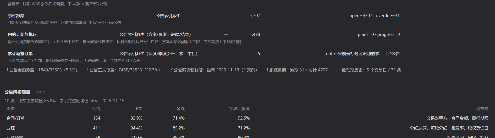](images/20-announcement-parse-quality.png)

**调整范围后，说明结果为什么变化**

在同一研究过程里，把「找 2026-11-13 公告」调整为「找 2026-11-13 合同公告」，结果从 **1,108 份变为 4 份**。变化摘要指出范围或条件、匹配清单、返回依据及待核事项的变化，而不是只给两个总数。图中「清单移出 1,104」表示这些文件不再匹配本次条件，原公告仍然保留。两次正文均为 0 份，缩小范围并没有消除正文缺口。

[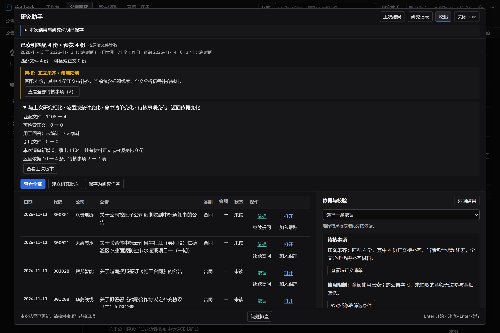](images/14-research-comparison.png)

研究员可以用「上次结果」来回核对，也可以从「研究记录」恢复已保存的范围、完整材料清单、依据和说明。**恢复只读取已保存结果，不自动重跑，也不把旧统计刷新成当前状态。** 完成记录保存在本机，进程缓存淘汰或程序重启后仍可恢复；历史入口按需列出最近 20 次摘要。

[查看研究记录与恢复入口](images/15-research-history.png)

结果变化还会核对共有材料的正文或来源指纹、引用和待核事项。只有保存了完整匹配集合时，才计算材料增减；集合不完整则明确提示差集未核定。当前范围是本机研究记录，不包含云同步或多用户审计。

**说出动作后，先核对对象**

输入「把这条标为已读」时，研究助手先预览具体公告、当前状态和影响范围，研究说明明确显示「尚未执行」。确认后按实际回执更新，符合条件的撤销也有对应回执。图中是确认前的预览状态。

[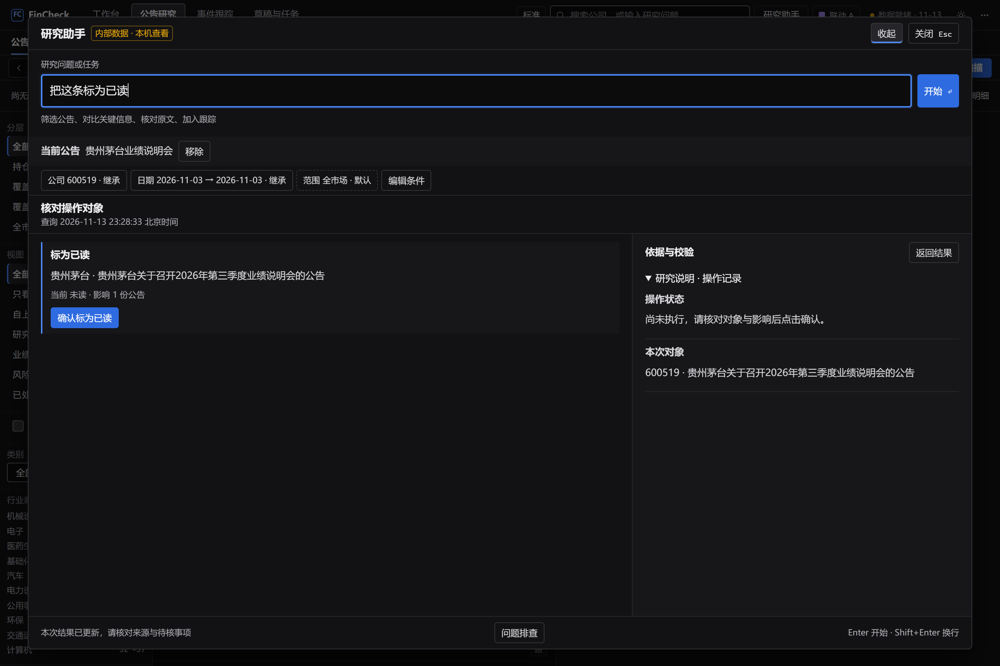](images/03-action-preview.png)

单条公告快评与 AI · 字段来源、检查状态、模型约束

在批次比较矩阵找到「首都在线 · 回购股份方案」，点击「核对」打开单份复核，再点「进入公告快评」。快评保留公司、公告与披露日期的上下文。首屏回答三个问题：**发生了什么、可以做什么量级测算、还有哪些问题需要核对**。研究员可以从这里打开原文、继续问这份公告，或整理点评草稿。

[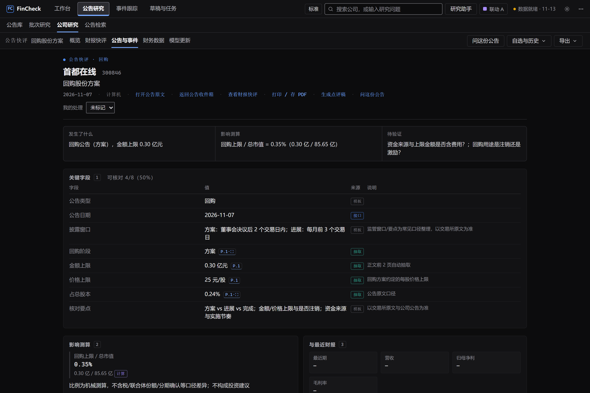](images/06-announcement-brief.png)

| 要防止的误读 | 这个样本中的界面做法 |
|---|---|
| 把计划写成已完成 | 快评明确标「方案」，把 **0.30 亿元**写成金额上限，并把实际回购进度列入后续核验 |
| 把原文数字与系统测算混用 | **25 元/股**、**占总股本约 0.24%**来自公告。**0.35%**是用图中市值口径计算的量级，页面列出 **0.30 亿 ÷ 85.65 亿** |
| 把缺失基线补成确定值 | 样本缺少财报快评基线，营收、归母净利等留空，只显示已有输入支持的市值口径测算 |
| 把模板当作公告事实 | 字段标明抽取、接口或模板，测算单独标为计算。披露窗口和核对要点注明模板来源 |
| 把有引用当成已审核 | 可定位字段提供页码，具有页内坐标的字段可高亮原文。最终人工判断回到复核和交付流程 |

打开「回购阶段」旁的页码，应用内 PDF 阅读器高亮原文标题「回购股份方案」。同一页还能读到 **2,000 万至 3,000 万元**的方案区间及价格上限。这个来回核对能看到快评中的 **0.30 亿元**是原文区间上限，以及原文为何仍以实际使用的资金总额为准。

[查看原图：在应用内打开公告原文第一页，定位回购方案并核对金额区间](images/07-announcement-pdf-evidence.png)

**从运行记录找到该核对的地方**

X-Ray 将定位公告、取得原文、识别字段、校验、生成结论和人工处理呈现为六步摘要，技术明细可按需展开。下图是同一份首都在线公告的另一次隔离运行。本次没有做比例测算，分母检查标为「不适用」，因此汇总只计算五项适用检查。金额单位检查显示正文找到了计量单位，研究员仍可回原文确认单位具体对应哪个数值。

[查看原图：快评新版 X-Ray，显示六步摘要、不适用的分母检查和待审核状态](images/26-xray-four-states.png)

| 检查结果 | 研究员下一步 |
|---|---|
| 通过 | 查看具体检查对象与原因，再核对将要采用的事实 |
| 冲突 | 回到相应字段或原文，核对金额、单位或口径 |
| 无法验证 | 补取正文、分母或必要的定位信息 |
| 不适用 | 确认本次没有相应检查需求，例如未做比例测算时无需分母 |

第六步读取本机记录的公告处理状态，快评页也提供「进入审核工作台」。研究结论是否有效确认，继续在对应的审核流程中核对。

查询范围、事实抽取、金额测算和状态写入由程序执行。模型可补足部分条件理解，或在独立入口中组织已检索证据、润色原稿。研究员负责核实业务含义并确认结论。

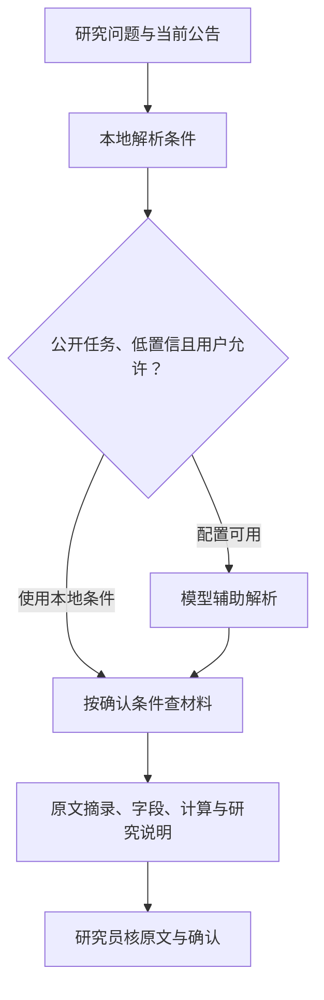

| 入口 | 依据与约束 | 失败后怎么继续 |
|---|---|---|
| 研究助手识别问题 | 配置可用且用户允许时，模型可补充低置信的公开搜索条件。程序校验意图、代码、日期与类别，明确规则和手动条件优先 | 使用已解析的本地条件，必要时请研究员澄清 |
| 「问这份公告」 | 继承当前公告和公司，限定材料范围，使用本地检索和原文摘录形成研究说明 | 提示缺口，保留补材料或调整范围入口 |
| 可选证据问答 | 在独立问答路径中，先筛公司、日期、类别与文件，再把材料身份、页码及摘录组织成编号证据。逐句校验引用、数字单位和规则可识别的语义 | 未通过校验时可带错误修正一次，仍失败则返回原文摘录 |
| 可选草稿润色 | 使用原稿和编号事实，核对事实编号、关键数字和结构 | 保留原稿供继续编辑 |

公告更正、表格勾稽与 CSV 导出

**发现公告更正，回到正确的披露文件**

创益通同一份补充法律意见先后有两次披露。研究员在「公告检索」输入标题关键词和日期范围，点击「查询」，默认返回 **2026 年 11 月 11 日修订稿**。勾选「显示被更新」并再次查询，可以同时找回 **2026 年 10 月 20 日原稿**。两条记录分别链接到各自的原文。

[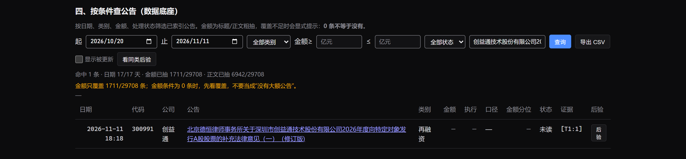](images/24-announcement-search-current.png)

[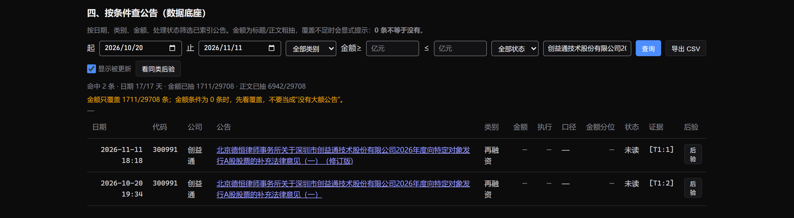](images/25-announcement-search-history.png)

从原稿进入快评，页面会提示后续修订日期。研究记录比较的是两次查询的范围和材料。这里回溯的是同一事项的两次披露。

[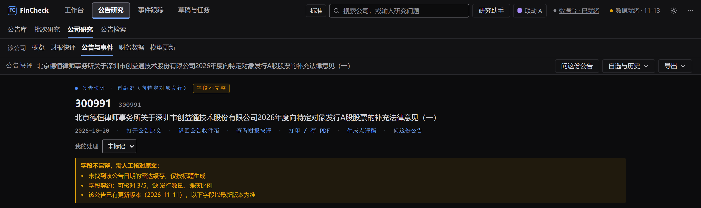](images/18-announcement-revision-notice.png)

本样本的字段页码还可能连回旧稿。核对修订后采用的数值时，从修订稿本身打开原文。 [10 月 20 日原稿](https://static.cninfo.com.cn/finalpage/2026-10-20/1225612802.PDF) · [11 月 11 日修订稿](https://static.cninfo.com.cn/finalpage/2026-11-11/1225667350.PDF)

**核对表格字段与计算所需输入**

航天环宇回购进展公告的第一页列出累计已回购 **50,000 股**、已回购金额 **1,867,469.63 元**和实际价格区间 **35.95–37.47 元/股**。快评标出这些字段的表格来源与页码，金额在界面中换算为亿元。研究员可用来源页检查原数、单位和「累计已执行」口径。 [公告原文第 1 页](https://static.cninfo.com.cn/finalpage/2026-11-12/1225667693.PDF#page=1)

[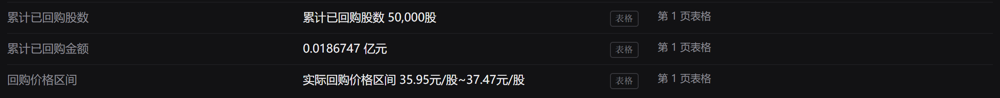](images/22-table-fields.png)

「字段勾稽」说明具体规则及核对结果。首都在线的回购方案样本中，系统给出一项金额区间规则通过提示，并因缺少完整价格区间将另一项标为「无法核验」。这个状态能提醒研究员先补齐比较输入。有明确冲突时，规则保留冲突原因供人工处理。

[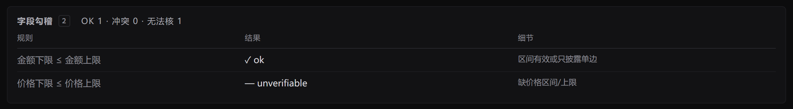](images/23-field-checks.png)

**导出沿用检索条件，冲突由研究员确认**

「导出 CSV」沿用页面上填写的日期、类别、金额、状态、关键词和「显示被更新」选项。用上面的公开公告样本实际下载后，CSV 包含原稿与修订稿两条记录。查询预览和导出的行数上限分别设置，筛选规则一致。

另用带有已记录勾稽冲突的隔离样本走完界面流程。点击导出会弹出冲突明细。**取消后没有新文件。确认后按原筛选条件继续导出，原冲突仍保留。**

**带着这份公告继续追问**

在快评点击「问这份公告」，研究助手继承公告对象、公司和日期。这个样本显示 **用于回答 1 份、引用原文 1 份**。结果用实际返回的原文摘录支撑回答，并提示部分摘录页码未定位。研究员可以打开来源核对完整语境。快评中的结构化字段和追问中的摘录各有自己的定位依据，页码状态分别展示。

[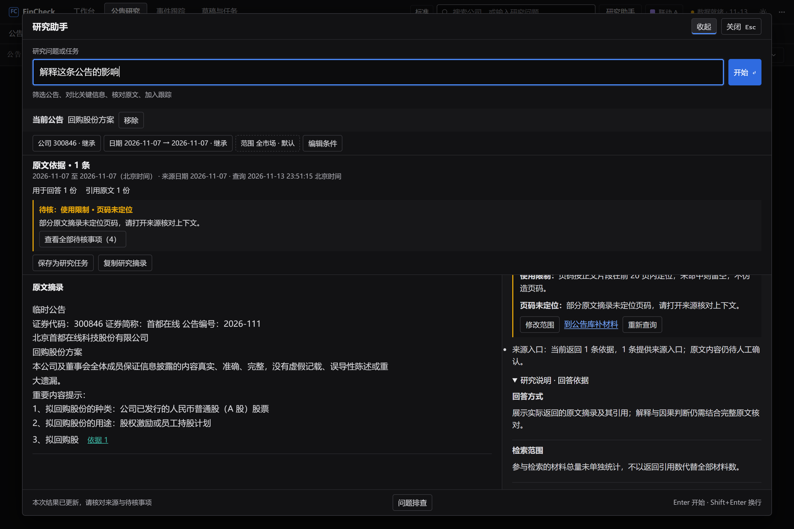](images/09-announcement-followup.png)

批次复核与晨会 · 人工状态、跟踪记录与纪要

**把一次筛选变成可继续的批次**

需要完整处理材料时，研究员从同次匹配清单建立批次。批次冻结公司、日期和文件 ID，暂停后可继续未完成任务，失败项保留并可重试。矩阵适合并排比较字段，异常复核用来处理缺字段、计算项及证据缺口。

| 状态看什么 | 典型状态 | 对下一步的影响 |
|---|---|---|
| 材料和解析 | 标题已收、正文就绪、有字段、解析失败 | 选择补正文、重试解析或核对字段 |
| 本次研究运行 | 等待、执行、已保存、失败或中断 | 决定继续等待、恢复已存结果或重新查询 |
| 人工处理 | 已读、待核、跟踪、已确认、有理由忽略 | 决定是否继续复核，以及当前结论是否进入对应交付 |

[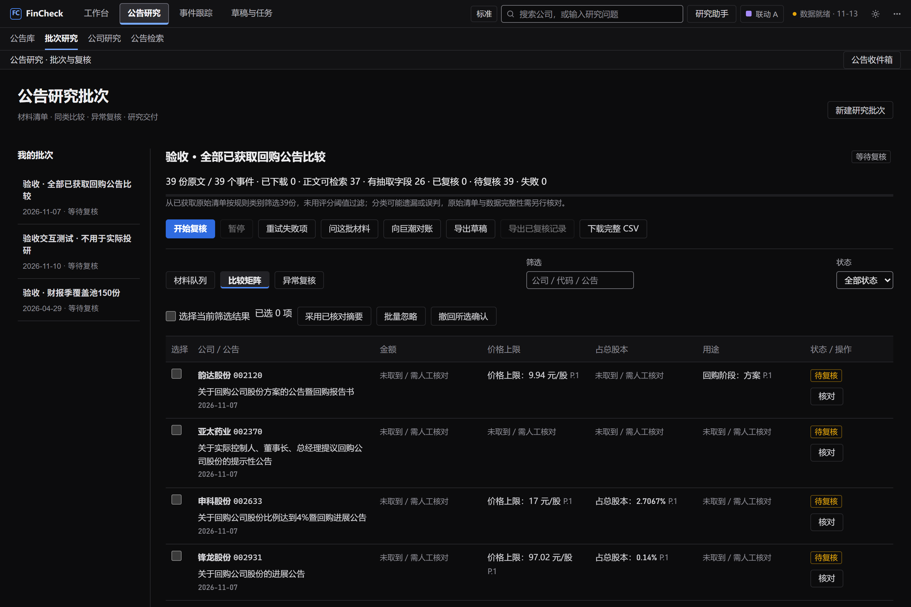](images/04-batch-matrix.png)

**让人工确认有具体对象**

单份复核同时提供抽取字段、原文页码、研究结论和复核说明。研究员确认的是这一次结果。相关材料或结论发生变化后，旧审核失效，撤回的结论也从已确认摘要退出。正式批次导出要求每份材料已确认或有理由忽略，待核内容仍可随草稿保留。

[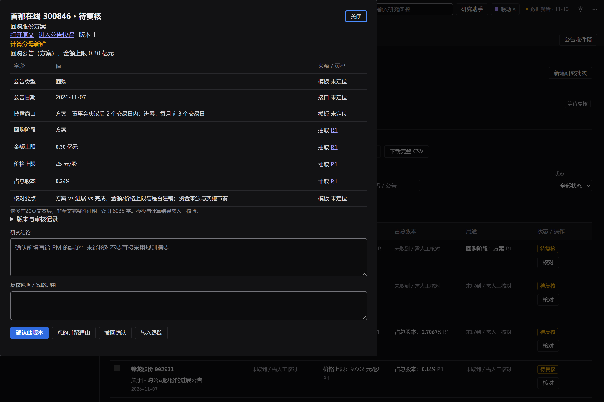](images/05-evidence-review.png)

**用不同入口承接后续研究**

需要持续关注同一事件时，可以转入跟踪，按日期回访，并核对新公告与原事项的关系。需要重复筛选一类材料时，可以保存最终条件。固定日期保留原区间，滚动日期按重跑日计算。双方材料集合完整且覆盖范围可比时，系统才展示可核定的新增与消失。

**把一条回购议题带到晨会和回访**

晨会从已有公告中选出少量议题，帮助研究员安排讨论顺序。首都在线回购方案进入样本议程后，卡片把讨论组织为四件事。**发生了什么、为什么重要、有哪些已设假设、接下来做什么。** 没有事先记录的假设时，卡片保留「未设假设」，研究员可从议题打开公告原文。

在隔离样本中，会上决定 **跟踪回购进度**。实际点击「跟踪」后，刷新页面仍能看到该决定。跟踪记录按原公告日期建立 **2026 年 12 月 7 日**回访事项，核对已回购金额、股数和价格上限是否调整。

[查看原图：晨会议题展示四个研究问题，已讨论摘要保留首都在线的跟踪决定](images/29-morning-research-decision.png)

生成纪要后，同一条议题保留「会上决定：跟踪」，其他议题仍可显示未决定。这个场景的行情源在隔离运行中不可用，页面仍可查看已取得的议题和决定。纪要与会后短版来自同次生成结果，改决定后直接复制旧纪要、跨日期切换与历史回放仍需单独核验。

[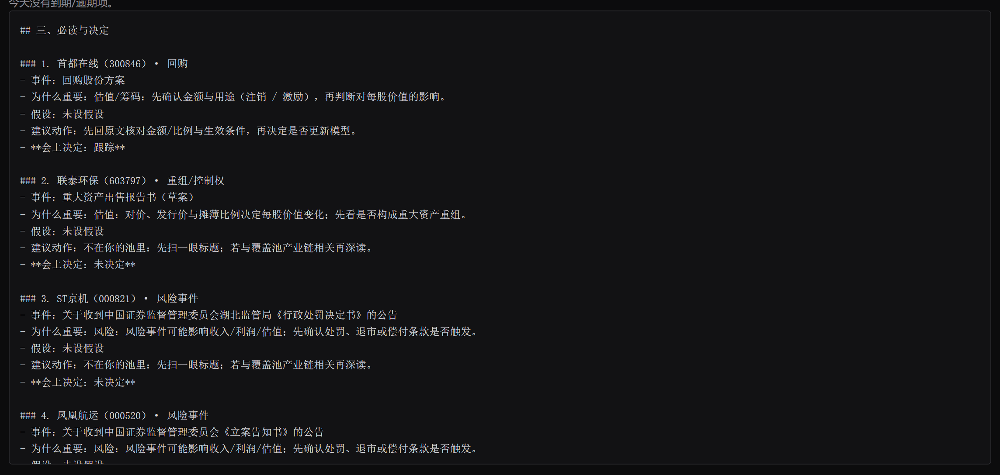](images/30-morning-minutes.png)

盘后数据台 · 模拟冲突阻断与重新生成

**盘后数据包被阻断后，按原条件继续**

在「盘后数据台」选择日期和数据集，按「我的池／自选」范围生成本机已入库数据的 ZIP。历史文件的就绪状态与本次提交结果分别展示，便于确认可下载的是哪一次生成。

隔离验收先生成一份公告清单，再为同一公告加入模拟勾稽冲突。再次提交时，表单下方显示**本次数据包未生成**及提交条件和冲突明细。日期和数据集仍保留，先前已就绪的数据包仍可查看，任务列表没有新增。实际研究中可回原文核对金额口径后重新提交。

[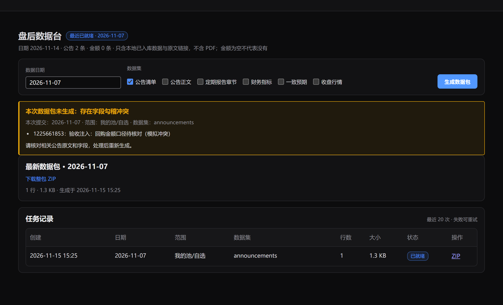](images/27-data-package-blocked.png)

清除隔离样本里的模拟冲突后，使用原条件重新提交。新任务最终显示「已就绪」，下载的 ZIP 包含公告清单、清单文件和说明，公告清单中可查到同一份公告。

[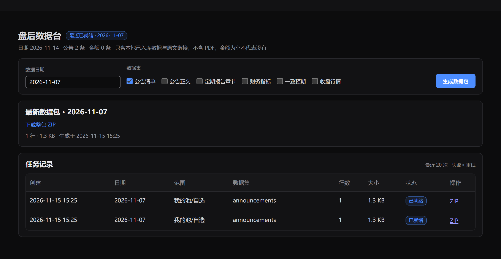](images/28-data-package-regenerated.png)

验收记录、适用范围与资料依据

| 验证对象 | 已有证据 |
|---|---|
| 图文与流程核对 | 研究助手此前已核对来源预览、真实进度、补充批次与刷新后恢复。实拍覆盖快评更正提示、表格来源、字段勾稽、公司导航、解析质量与数据包就绪。已下载样本 ZIP 并核对公告清单和清单文件 |
| 公告检索与 CSV | 用同一公开公告样本实际查询当前披露和历史披露，并下载 CSV 核对两条记录。源码和打包程序的浏览器复测也覆盖了正常下载、筛选一致、冲突取消和显式确认，使用独立构造的冲突样本 |
| 财报快评与研究问答 | 使用贵州茅台缓存三季报实拍快评，打开侧栏原文第 1 页，再从「问这家公司」完成财报提问，核对公司上下文、累计营收依据与异常说明 |
| AI 回退和 X-Ray | 以公开公告摘录和本地构造的错误候选验证实施状态检查、修正次数和摘录回退。实拍同一公告另一次运行，核对适用检查分母与公告处理状态 |
| 盘后与晨会 | 使用隔离数据复测生成阻断、条件保留、重新生成及 ZIP 内容。实际记录一条晨会跟踪决定，刷新后检查决定，并核对生成的纪要与到期跟踪记录 |
| 批次工作量 | 一次隔离验收覆盖 150 份原始文件，其中 146 份正文可检索，4 份缺口显式保留，150 份均处于待人工复核 |
| 后端回归 | 实施记录包含 815 项 Python 回归通过，覆盖运行幂等、安全停止、持久结果、正文指纹和精确补充批次等场景；有 3 条既有弃用警告 |
| 界面与流程 | 四项改进的浏览器专项 19 项通过；原研究助手流程 32 项、说明与诊断专项 19 项、界面质量检查 10 项通过。覆盖来源卡与焦点、缺口分页、恢复与切换、操作回执和窄屏等行为 |
| 打包后恢复 | 冻结后端与真实进程重启专项 9 项通过，验证完成结果、完整分页和前后结果比较仍可读取；此项引用项目验收记录 |

图中覆盖和完整度来自隔离数据，人工字段准确率需用独立复核样本验证。下一阶段用规模和难度相近的真实研究任务观察研究员能否**说清范围、找到对应原文、补齐指定缺口，并解释前后结果变化**，同时记录核验耗时与操作数、原文核验成功率、重要遗漏及返工。

对照现有实现，批次生成式综合研究与反证组织仍在方案阶段。快评可保存本次结果供接口按运行标识读取，页面到点评稿的关联以及公告更正后的逐字段来源和依赖重算仍待核验。

**资料依据**

FinCheck 产品需求文档、研究说明与公告研究全流程设计方案、事件身份与去重记录、公告解析与勾稽记录、公告检索与 CSV 复测记录，以及快评 X-Ray、晨会和盘后数据台的实施与验收记录。

*截图取自运行中的界面与隔离验收数据，整屏与细节分别呈现。点击图片可查看原尺寸 PNG。*

[查看一页纸产品说明](一页纸产品说明.md) · [返回作品集首页](../README.md)

