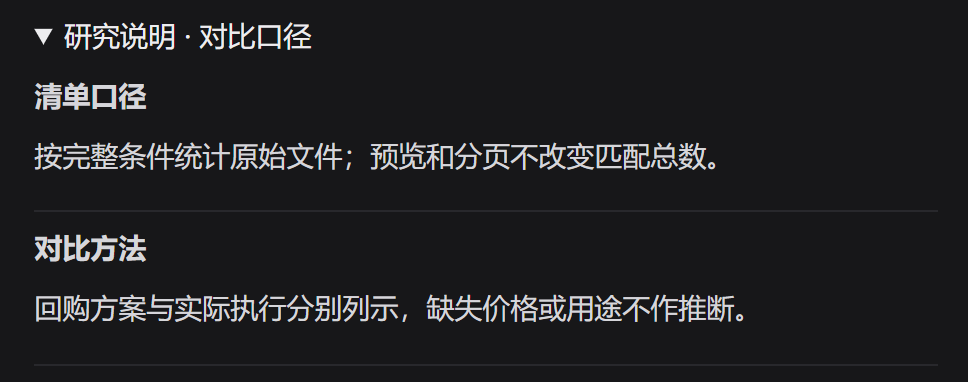

# FinCheck｜买方公告研究工作台

> 面向买方研究员，将公告查找、批量比较、原文核验、人工结论和跟踪交付连成一条研究流程。

**谁在用，为什么需要它**  
行业研究员持续跟踪覆盖公司与持仓公司，公告高峰可能遇到上百份公告和附件。基金经理助理整理晨会与回访事项，基金经理阅读已复核结论。三方需要对齐材料范围、比较口径和结论依据，才能把研究推进到下一步。

**一条典型流程**  
确定公司与日期 → 获取公告并核对清单 → 筛选或建立研究批次 → 比较字段 → 打开研究说明和原文 → 人工确认或带理由忽略 → 跟踪事件、整理晨会稿或保存任务复用。重点排序决定先看哪些材料，批次保留原始文件及附件。

**核心功能 · 研究说明**  
研究助手负责发起查询、比较和操作预览。「研究说明」位于结果的「依据与校验」区域，帮助研究员判断这次结果能用到什么程度。

| 研究员要判断什么 | FinCheck 怎样呈现 |
|---|---|
| 这次查了哪些材料？ | 显示最终范围，分别统计匹配文件、可检索正文及适用的回答、引用文件数。统计按同次查询快照固定。 |
| 这些数字能直接比较吗？ | 展示报告期、单位和口径。回购方案金额与实际执行金额分列，缺失价格或用途保留为空。 |
| 哪些地方需要核对？ | 摘要先提示缺正文、缺字段、页码未定位等限制。依据区提供来源、修改范围、补材料及重新查询入口。 |
| 操作已经发生了吗？ | 预览显示真实对象和「尚未执行」。确认和撤销后，说明按实际回执更新。 |

**系统与研究员的分工**  
规则与工具负责查询、计算和状态，研究说明从同次结果、证据与回执按规则生成。研究助手的解释路径使用本地检索和原文摘录，公开任务的模型辅助解析需显式启用。研究员负责核原文、确认结论和决定跟踪或交付，正式导出受审核门禁约束。

**当前状态与验证**  
Windows 1.24.0 已提供研究助手、研究说明、批次、人工复核和跟踪工作流。本次截图核对了对比口径、正文缺口及操作预览。真实研究效果待试用，计划记录研究说明理解正确率、原文核验成功率、任务耗时、重要遗漏及返工。

[查看完整项目案例](README.md) · [返回作品集](../README.md)

*依据 FinCheck PRD v7.30 §2、§3、§5、§6.4–6.5、§7 及 1.24.0 发布记录。*
